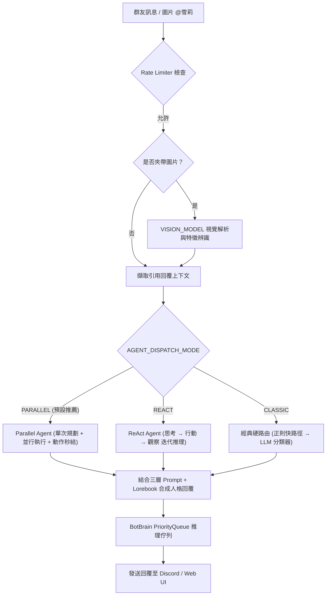

# 🤖 橘雪莉 — Discord AI Companion & Agent Platform (v1.6.0)

> 📌 **本文件為歷史版本存檔 (Archive)**。若要查看最新版規格與文件，請參閱根目錄 [README.md](../README.md)。

一個擁有獨立靈魂、會讀空氣、懂得自我反思、還會自己找樂子的 Discord 虛擬實況群友與全能 AI 代理人。  
基於 **discord.py 2.x** + **ReAct / Parallel Agent 雙智能推理架構** + **多 LLM 本地 (Ollama/LM Studio/vLLM) 與雲端 (OpenAI/Gemini/DeepSeek/Claude) 引擎** + **asyncio 優先權佇列**，支援 Linux / Docker 容器化與 Windows 跨平台部署，具備多模態視覺感知、自我形象辨識、豐富擴充模組系統 (Mod System) 與全功能 Web 視覺化主控台。

---

## ✨ v1.6.0 主要能力矩陣 (Core Capabilities)

| 類別 | 功能亮點 |
|---|---|
| 🧠 **智慧 Agent 架構** | **Parallel Agent** 單次規劃並行調度 · **ReAct Agent** 多輪推理工具鏈 · **Action Early Termination** 動作自適應秒結 · 複合指令自動拆解 · 自然語言 @Tag 回應 · 主動插話 (Interject) · 讀空氣 (VibeManager) · 心跳定時主動任務 (Heartbeat) |
| 👁️ **多模態視覺與認知** | **多模態圖片深度解析 (`VISION_MODEL`)** · **跨模組自我形象辨識 (`⚠️自我辨識` Lorebook 觸發)** · **引用回覆上下文感知 (Quote Context)** |
| 🛠️ **全能工具與技能庫** | 台美股即時 K 線技術分析 (`/stock`) · 即時天氣預報 (`/weather`) · 網頁深度 RAG 搜尋 (`/search`) · Safebooru/Pixiv 搜圖 · 自然語言與 cron 定時排程提醒 (`/schedule`) · `/execute` 工具獨立測試 |
| 🎨 **創作與多媒體** | Stable Diffusion 圖片生成 (`/draw`) · YouTube 音樂點播與音訊串流 (`/play`) · **YouTube 影片指定秒數轉 GIF 動圖 (`/video`)** |
| 🔌 **擴充模組 (Mod System)** | **AI 社群情報哨兵 (`feed_sentinel`)** · **美股虛擬量化交易系統 (`stock_trader`)** · **TRPG D&D 地下城主跑團 (`dnd`)** · **小遊戲遊樂場 (`game_center`)** · **技術指標晨晚報與 PTCG 追蹤 (`market_plugin`)** |
| 🎤 **語音系統 (Voice)** | Discord 語音通話 · faster-whisper STT 語音辨識 · XTTS-v2 聲音克隆 TTS · Silero VAD 語音活動檢測 · **語音房與音樂動態實時監控** |
| 🧠 **動態記憶與社交** | UID 長期記憶萃取 · **記憶物理消毒 (`sanitize_memory`) 防錯亂** · 好感度等級追蹤 (`RelationshipManager`) · 每日聊天精華摘要 (`NightlyDigest`) · **新人加入動態歡迎 (`WelcomeCog`)** |
| 🖥️ **Web 控制台 2.0** | **總覽主控台 Dashboard** (CPU/RAM/GPU/Network + Git 双版本比對) · **地端 AI 服務即時監測** (Ollama/LMS/vLLM/SD) · **美股虛擬炒股持倉看板** · **模組管理與熱重啟 (Mod Manager)** · **大腦推理佇列 (LLM Task Queue) 實時監控** |
| 🛡️ **資安與審計** | **管理員登入與操作歷史審計 (`./data/admin_audit.jsonl`)** · IP 暴力破解防禦鎖定 · 時序攻擊防禦 · Guest 唯讀模式 · 敏感 Token 掩碼防洩漏 · XSS 防護 |
| 🐧 **容器與跨平台** | **Linux / Docker 容器化完整支援** · **`0.0.0.0` 綁定自動降級** · **`.sh` / `.bat` 跨平台重啟與自動更新守護腳本** |

---

## 🧠 v1.6.0 核心 Agent 架構與調度機制

雪莉具備三模態動態調度架構，可透過 `.env` 的 `AGENT_DISPATCH_MODE` 或 Web UI 即時切換：

1. **Parallel Agent (並行任務調度器，預設模式)**：
   - 採用單次規劃（Single-Pass Inference）由 `PARALLEL_PLANNER_MODEL` 輸出結構化任務 JSON 與對話抑制標記 (`needs_persona_reply`)。
   - 使用 `asyncio.gather` 並行同時發動互不依賴的工具（例如：同時搜圖 + 查天氣 + 查台股走勢）。
   - 支援 **行為自適應終止 (Action Early Termination)**：若發動的工具全為 DIRECT_UI（如點歌、搜圖、畫圖）且無對話需求，動作完成即刻秒結，不產生多餘廢話文字。
2. **ReAct Agent (多輪推理與工具鏈模式)**：
   - 採用經典 Reasoning + Acting「思考→行動→觀察」迭代迴圈（`REACT_MAX_STEPS`），支援 `<thought>`、`<action>`、`<action_input>`、`<final_answer>`。
   - 適用於複雜多步驟相依推理（如：先搜尋特定新聞，再根據搜尋結果總結並畫圖）。
3. **Classic Agent (經典單意圖硬路由模式)**：
   - Phase 1 正則極速命中 → Phase 2 分類器神經判斷 → 專用工具執行。

---

## 🔌 擴充模組系統 (Mod System)

雪莉採用鬆散耦合的 Plugin 架構，系統於啟動時自動掃描 `./mod/` 目錄下所有包含 `cog.py` 的子資料夾並嘗試載入：

1. 📰 **`feed_sentinel` — AI 社群情報哨兵 & 主動話題探勘**：每日 08:00~23:00 每 15 分鐘自動巡邏 RSS/情報來源，自動去重並由 BotBrain 提煉 3 點繁中重點與雪莉犀利銳評，主動推播至 Discord 頻道。
2. 📈 **`stock_trader` — 雪莉美股虛擬量化交易系統**：自帶 $10,000 美金虛擬本金，美股交易時段 (台灣時間 23:00~04:00) 自動巡邏，03:50 臨關盤強制看盤。結合 AI 策略分析師 (`TradeStrategist`) 與演算法交易員 (`AlgoTrader`) 執行自動交易與風控，成交自動推播至頻道。
3. 🎬 **`video_clipper` — YouTube 影片轉 GIF 動態截取**：快速將 YouTube 指定時間片段轉換為高畫質 GIF 動圖發送至頻道 (`/video`)。
4. 🎲 **`dnd` — D&D TRPG AI 地下城主跑團遊戲引擎**：地下城主 AI (DM)、角色卡、屬性骰判定 (優勢/劣勢)、冒險行動互動與動態世界模擬。
5. 🎮 **`game_center` — 小遊戲遊樂場**：支援 21 點、猜拳、踩地雷、海龜湯、井字棋、密室逃脫，並結合地端 LLM 進行雪莉名偵探個性對弈與調侃。
6. 📊 **`market_plugin` — 股市與卡價追蹤**：技術指標晨報 (08:00)、Gemini AI 晚間分析 (21:30)、PTCG 卡片即時報價 (10:00)、ETF 溢折價監控 (盤中每 10 分鐘)。

---

## 📋 v1.6.0 更新日誌 (Release Notes)

### 🧠 1. Parallel Agent & ReAct Agent 雙智能推理架構
- **Parallel Agent 高效並行調度 (預設)**：透過 `PLANNER_MODEL` 進行單次規劃，輸出結構化任務 JSON，使用 `asyncio.gather` 同步並行執行互不依賴的工具（如同時搜圖+查天氣+查股價），效能提升 300%！
- **Action Early Termination (動作自適應秒結)**：當發動的工具全為 DIRECT_UI（如點歌、搜圖、畫圖）且無對話需求時，動作完成即刻秒結，不產生多餘廢話文字。
- **ReAct Agent 鏈式推理**：支援經典「思考→行動→觀察」多步推理迴圈，支援 `<thought>`、`<action>`、`<action_input>` 與 `<final_answer>`，在多步驟相依任務時精準收斂。
- **調度模式動態切換 (`AGENT_DISPATCH_MODE`)**：支援 `PARALLEL` / `REACT` / `CLASSIC` 三種模式，可由 `.env` 或 Web UI 即時調整。
- **Tool Registry 全面標準化**：Chat, Draw, Image, Music, Schedule, Search, Stock, Weather 工具全面重構，支援標準 ToolResponseMode。

### 👁️ 2. 多模態視覺感知與自我形象認知 (Multimodal Vision & Self-Awareness)
- **多模態圖片深度解析 (`VISION_MODEL`)**：群友在 Discord 上傳圖片並 @雪莉 或輸入問題時，自動調用視覺模型（如 `minicpm-v` / `qwen2-vl`）進行超高細節藝術與文字解析。
- **跨模組自我形象辨識與自我意識動態觸發 (`⚠️自我辨識` Lorebook)**：當視覺解析偵測到雪莉外觀特徵（淺藍/丸子頭/甜甜圈/白鳥/偵探帽/羽毛帽等）時，自動觸發 `⚠️自我辨識` 信號，動態注入自我認知人設（雪莉會認出「這是我自己！」）。
- **引用回覆上下文感知 (Quote Context)**：回覆或引用訊息時，自動擷取被引用的上下文與對話者，融入思考提示詞。

### 🔌 3. 擴充模組系統 (Mod System) 大幅擴充
- **AI 社群情報哨兵 (`mod/feed_sentinel`)**：每 15 分鐘背景巡邏 RSS/情報來源（08:00~23:00），自動去重並由 BotBrain 提煉 3 點繁中重點與雪莉犀利銳評，主動推播至 Discord 頻道。
- **雪莉美股虛擬量化交易系統 (`mod/stock_trader`)**：具備 $10,000 虛擬本金，美股盤中交易時段（23:00~04:00）自動巡邏，03:50 臨關盤強制看盤，結合 AI 策略分析師 (`TradeStrategist`) 與演算法交易員 (`AlgoTrader`) 執行自動交易與風控，成交自動推播至頻道。
- **YouTube 影片轉 GIF 工具 (`mod/video_clipper`)**：提供 `/video` 斜線指令，快速產出指定時間片段的高畫質動態 GIF。
- **D&D TRPG 跑團系統 (`mod/dnd`)**：地下城主 AI (DM)、角色卡、屬性骰判定、冒險行動與世界模擬。
- **小遊戲遊樂場 (`mod/game_center`)**：21點、猜拳、踩地雷、海龜湯、井字棋、密室逃脫與雪莉名偵探 AI 對弈。

### 🧠 4. 記憶系統全面防護與記憶錯亂修復
- **記憶錯亂修復與清洗 (`sanitize_memory.py`)**：重構 UID 長期記憶萃取演算法，解決記憶重複注入、人設混淆與幻覺問題；統一由 `MemoryManager` 注入，避免重複消耗 10-15% Token。
- **社交好感度系統 (`RelationshipManager`)**：被 Tag、對話即時更新群友好感度與關係等級。
- **每日夜間聊天摘要 (`NightlyDigest`)**：定時整理各頻道聊天精華。

### 🖥️ 5. Web 管理控制台 2.0 深度升級
- **新增「📈 雪莉虛擬炒股」面板**：視覺化美股持倉、未實現損益、AI 決策思路日誌、一鍵「刷新行情損益」與「手動評估看盤」。
- **新增「🧩 模組管理 (Mod Manager)」面板**：視覺化管理 `./mod/` 各外掛模組，支援一鍵熱重啟與停用。
- **視覺化 ReAct / Parallel 思考推理歷程**：測試室與即時日誌面板支援結構化思考歷程與工具調用展開。

### 💬 6. 社交體驗與互動感深化
- **新人加入動態歡迎 (`WelcomeCog`)**：新成員加入伺服器時，自動以雪莉人設語氣動態生成專屬歡迎詞。
- **互動式幫助面板 (`/help`)**：提供 Discord Select Menu 分類式幫助清單。
- **動態狀態輪播 (`presence_loop`)**：自動切換生動的雪莉名偵探活動狀態。
