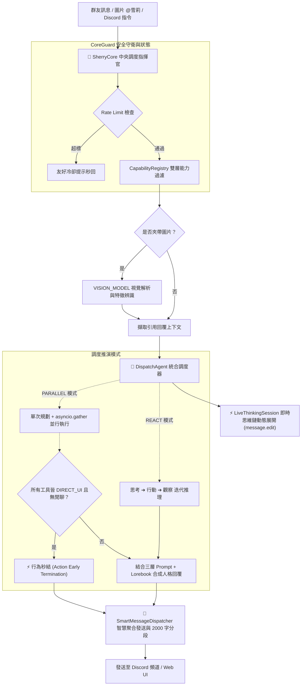

# 🤖 橘雪莉 — Discord AI Companion & Agent Platform (v1.8.0)

> 📌 **本文件為歷史版本存檔 (Archive)**。若要查看最新版規格與文件，請參閱根目錄 [README.md](../README.md)。

一個擁有獨立靈魂、會讀空氣、懂得自我反思、精通深度探研與數位藝術創作的 Discord 虛擬實況群友與全能 AI 代理人。  
基於 **discord.py 2.x** + **SherryCore 微核心調度架構** + **8 大 LLM 推理引擎 (Ollama / LM Studio / vLLM / OpenRouter / OpenAI / Gemini / DeepSeek / Claude)** + **asyncio 優先權佇列**，支援 Linux / Docker 容器化與 Windows 跨平台部署，具備即時動態思維鏈展開、條件觸發情報推播 (SPARK)、系統效能診斷採樣 (SysMonitor)、地端深度研究、數位畫布創作、實況劇院、個性化毒舌吐槽、多模態視覺自我認知、11 大擴充模組系統 (Mod System) 與全功能 Web 視覺化主控台。

---

## ✨ 主要能力矩陣 (Core Capabilities)

| 類別 | 功能亮點 |
|---|---|
| 🎼 **微核心架構 (SherryCore)** | **SherryCore 樂團指揮家調度** · **雙層能力註冊隔離 (CapabilityRegistry)** · **安全守衛與顯存協調 (CoreGuard)** · **智慧單一聚合輸出與 2000 字自適應分段 (SmartMessageDispatcher)** · **即時心智快照 (SherryMindState)** |
| 🧠 **智慧 Agent 架構 & 動態思維流** | **DispatchAgent 統合調度** · **LiveThinkingSession 即時動態編輯思考推演 (`message.edit` 零延遲防抖展開)** · **Parallel Agent** 單次規劃並行調度 · **ReAct Agent** 多輪推理工具鏈 · **Action Early Termination** 動作自適應秒結 · 複合指令自動拆解 · 自然語言 @Tag 回應 · 主動插話 (Interject) · 讀空氣 (VibeManager) |
| ⚡ **條件觸發與情報推播 (SPARK Engine)** | **全新 SPARK 模組 (`mod/spark`)** · **4 大動態觸發器** (價格監控 `price` / 定期排程 `schedule` / RSS 資訊源 `rss` / 天氣劇變 `weather`) · **NLP 自然語言意圖解析** · **防過度推播與冷卻風控** · **Web UI 專屬推播管理看板 (`spark.html`)** |
| 📊 **系統效能診斷與採樣 (SysMonitor)** | **全新效能監測模組 (`mod/sys_monitor`)** · **低干擾記憶體緩衝採樣 (CPU/DRAM/GPU/Storage/進程 RSS/IO)** · **每 30 秒批次落盤 JSONL** · **Discord `/sys_status` 炫彩狀態儀表** · **Web UI 即時動態效能趨勢圖 (`sys_monitor.html`)** |
| 🎛️ **現代化交互式 UI (Discord Views)** | **全面升級 Discord View/Button/Select 元件** · **音樂播放器互動控制面板 (`handlers/music/ui.py`)** · **D&D 跑團冒險操作面板 (`mod/dnd/views.py`)** · **實況劇院控制 UI** · **股市卡牌行情面板** · **`/execute` Command Hub 下拉式模組預覽中樞** |
| 🔬 **地端深度研究 (Deep Research)** | **10~30 分鐘級多輪自主深思推演** · **全網實時檢索與交叉文獻比對** · **批判性反思與論點自我驗證** · **論文級繁中學術報告生成** · **Web UI 專屬深度研究推演主控台** |
| 🎨 **藝術與創作工作室 (Creative Studio)** | **雪莉數位畫布繪圖引擎 (`mod/painter`)** (多筆刷系統 / 調色盤 / Gemma 多模態視覺臨摹 / 歷史畫廊) · Stable Diffusion 圖片生成 (`/draw`) · **實況劇院與大螢幕影音播放 (`mod/livestream`)** · YouTube 音樂串流 (`/play`) · 影片指定秒數轉 GIF (`/video`) |
| 💬 **毒舌銳評與吐槽 (Roast Engine)** | **關鍵字自動監聽與機率擲骰判定** · **雪莉名偵探毒舌銳評 / 傲嬌吐槽動態人設** · 頻道冷卻風控機制 · **Web UI 吐槽專屬管理看板 (`roast.html`)** (支援規則配置、風格切換與即時發送) |
| 🌐 **8 大 LLM 推理矩陣** | **全新支援 OpenRouter (`openrouter:`)** · **支援 FreeToken 雲端端點** · 本地主力 (**Ollama / LM Studio / vLLM**) · 雲端主力 (**OpenAI / Gemini / DeepSeek / Claude**) · ClientSession 連線池複用與動態前綴路由 |
| 👁️ **多模態視覺與自我認知** | **多模態圖片深度解析 (`VISION_MODEL`)** · **跨模組自我形象辨識 (`⚠️自我辨識` Lorebook 觸發)** · **引用回覆上下文感知 (Quote Context)** |
| 🛠️ **全能工具與技能庫** | 台美股即時 K 線技術分析 (`/stock`) · 即時天氣預報 (`/weather`) · 網頁深度 RAG 搜尋 (`/search`) · Safebooru/Pixiv 搜圖 · 自然語言與 cron 定時排程提醒 (`/schedule`) · `/execute` 全能工具獨立測試與預覽 |
| 🔌 **11 大擴充模組系統 (Mod System)** | **11 大外掛模組熱插拔**：條件推播 (`spark`) · 系統監控 (`sys_monitor`) · 深度研究 (`deep_search`) · 畫布工作室 (`painter`) · 實況劇院 (`livestream`) · AI 社群哨兵 (`feed_sentinel`) · 美股虛擬量化交易 (`stock_trader`) · D&D 跑團 (`dnd`) · 小遊戲遊樂場 (`game_center`) · 股市卡價追蹤 (`market_plugin`) · 影片 GIF (`video_clipper`) |
| 🎤 **語音系統 (Voice)** | Discord 語音通話 · faster-whisper STT 語音辨識 · XTTS-v2 聲音克隆 TTS · Silero VAD 語音活動檢測 · **語音房與音樂動態實時監控** |
| 🧠 **動態記憶與社交體驗** | UID 長期記憶萃取 · **記憶物理消毒 (`sanitize_memory`) 防錯亂與杜絕幻覺** · 好感度等級追蹤 (`RelationshipManager`) · 每日聊天精華摘要 (`NightlyDigest`) · **長對話話題連續性增強** · **新人加入動態歡迎 (`WelcomeCog`)** |
| 🖥️ **Web 控制台 2.0** | **13 大模組看板**：總覽主控台 (Dashboard) · 即時日誌 · 系統資源 · 任務排程與大腦推理佇列 · 雪莉測試室 · 地端 AI 服務即時監測 · **SPARK 條件推播管理** · **SysMonitor 效能圖表** · 深度研究主控台 · 畫畫工作室 · 雪莉吐槽管理 · 美股炒股看板 · 管理員審計 |
| 🛠️ **獨立終端監控工具** | **`tools/` 專用運維套件**：大腦佇列監控 (`monitor_brain.py`) · 情報哨兵即時追蹤 (`monitor_sentry.py`) · Web UI 狀態監控 (`monitor_web.py`) |
| 🛡️ **資安與審計** | **管理員登入與操作歷史審計 (`./data/admin_audit.jsonl`)** · IP 暴力破解防禦鎖定 · 時序攻擊防禦 · Guest 唯讀模式 · 敏感 Token 掩碼防洩漏 · XSS 防護 |
| 🐧 **容器與跨平台** | **Linux / Docker 容器化完整支援** · **`0.0.0.0` 綁定自動降級** · **`.bat` / `.sh` 跨平台快速啟動與重啟腳本 (`start_sherry_tabs.bat` / `open_web_ui.bat`)** |

---

## 🧠 核心 Agent 架構與微核心調度機制

雪莉採用 **SherryCore 中央調度微核心** 統籌所有生命週期，並結合 **DispatchAgent** 與 **LiveThinkingSession** 達成毫秒級響應與流暢思考視覺反饋：

---

## 📋 v1.8.0 更新日誌 (Release Notes)

### 🎼 1. 全新架構：SherryCore 中央調度微核心 (`core/`)
- **微核心架構升級**：建立統一請求生命週期標準 (`SherryRequest` -> `SherryResponse`)，以 Orchestrator 作為樂團指揮家統籌全生命週期。
- **雙層能力註冊隔離 (`CapabilityRegistry`)**：將精選日常 AI 工具與專題 Mod 外掛嚴格隔離，大幅避免 Prompt 污染並節省 15% 以上 Token 開銷。
- **安全守衛與智慧發送 (`CoreGuard` & `SmartMessageDispatcher`)**：強化頻率限制與顯存協調，智慧聚合 Embed 與附件，精準自適應處理 2000 字分段發送。

### ⚡ 2. 全新模組：SPARK 條件觸發推播與情報探勘引擎 (`mod/spark`)
- **4 大動態觸發器**：支援股價/加密貨幣行情 (`price`)、定時與排程事項 (`schedule`)、RSS 即時新聞巡邏 (`rss`) 與氣象劇變監測 (`weather`)。
- **智慧 NLP 意圖解析**：支援以自然語言直接建立推播規則，具備智慧冷卻與防洗版風控。
- **Web UI 專屬管理面板 (`spark.html`)**：支援視覺化啟停、新增與立即檢查觸發器。

### 📊 3. 全新模組：SysMonitor 系統效能診斷與採樣監控 (`mod/sys_monitor`)
- **低干擾零頻繁開關檔架構**：記憶體緩衝高頻採樣，每 30 秒批次落盤 JSONL，精確監控 CPU、DRAM、NVIDIA GPU、主程式 RSS 與磁碟寫入。
- **Discord `/sys_status` 狀態儀表**：一鍵輸出伺服器即時負載與硬體健康狀態。
- **Web UI 效能趨勢圖 (`sys_monitor.html`)**：提供即時時間序列圖表與診斷日誌。

### 🧠 4. DispatchAgent 統合調度與 LiveThinking 即時動態思維流
- **統合調度 Agent 重構**：合併重構 `parallel_agent` 與 `react_agent` 為強大的 `dispatch_agent.py`，保持極致模組清晰度。
- **LiveThinking 動態思考展開 (`streaming_thinking.py`)**：以 Discord `message.edit` 原地動態更新技術模擬現代 AI 逐階段展開思考的視覺反饋，搭配非同步節流防抖，0 延遲且 0 阻塞。
- **可觀測性全面強化 (`observability.py`)**：全鏈路追蹤 Trace ID、耗時度量與結構化審計。

### 🎛️ 5. Discord 現代化 View 交互式介面全面升級
- **音樂留聲機面板 (`handlers/music/ui.py`)**：全新設計播放、暫停、切歌、音量調節、單曲循環與播放清單 View 按鈕與選單。
- **D&D 跑團冒險互動 (`mod/dnd/views.py`)**：將 TRPG 動作、擲骰判定與角色卡檢視完整轉化為 Discord View 交互按鈕。
- **Command Hub 預覽中樞 (`handlers/executor/cog.py`)**：升級 `/execute` 指令，支援下拉選單動態預覽各模組介面與自訂意圖測試。

### 🛠️ 6. 獨立終端監控與運維工具組 (`tools/`)
- **新增 3 大終端專用監控腳本**：`monitor_brain.py` (大腦推理佇列實時深度)、`monitor_sentry.py` (情報哨兵巡邏狀態)、`monitor_web.py` (Web UI 與連線狀態)。
- **一鍵多分頁啟動腳本**：新增 `start_sherry_tabs.bat`、`open_browser.bat`、`open_livestream.bat` 等運維輔助工具。

### 🌟 7. 人設深化與長對話話題連續性增強
- **話題連續性優化**：調整 Prompt 人設架構與上下文記憶檢索策略，讓雪莉在多輪對話中具備更強的話題延續性與自然語氣。
- **靈動吐槽精準度提升**：優化 Roast 觸發規則與名偵探人設注入。

### 🌐 8. Web UI 2.0 擴充至 13 大控制面板
- **全面整合 SPARK 與 SysMonitor 模組**：Web 導航列無縫嵌入全新管理分頁，提供更完整的視覺化運維體驗。
- **修復多項前端參數缺失與樣式適配**。

---

## 📚 歷史版本技術文件 (Historical Versions)

| 版本 | 文件連結 | 核心里程碑 |
|---|---|---|
| **v1.7.0** | [Docs/README_V1.7.0.md](./Docs/README_V1.7.0.md) | 地端深度研究 (Deep Research)、數位畫布繪圖 (Painter)、名偵探毒舌銳評 (Roast)、實況劇院、OpenRouter 支援 |
| **v1.6.0** | [Docs/README_V1.6.0.md](./Docs/README_V1.6.0.md) | Parallel/ReAct 雙智能架構、多模態視覺與自我認知、6大外掛模組、記憶物理消毒 |
| **v1.5.0** | [Docs/README_V1.5.0.md](./Docs/README_V1.5.0.md) | Linux/Docker 容器化相容、vLLM 推理引擎支援、.env 優先級、NumPy 2.x 相容 |
| **v1.4.0** | [Docs/README_V1.4.0.md](./Docs/README_V1.4.0.md) | 大腦即時推理佇列、地端 AI 服務監測、管理員審計落盤、延遲追蹤與 Dashboard |

---

## 📄 License

本專案採用 [MIT License](LICENSE) 授權開源。
