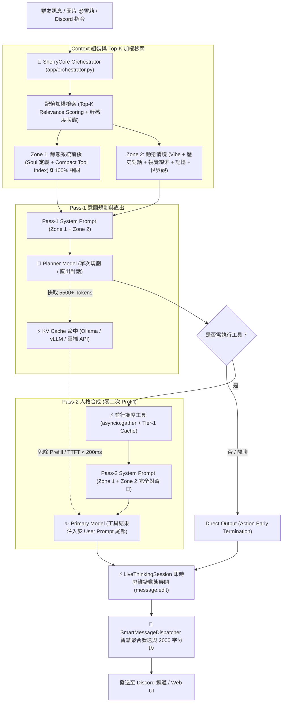

# 🤖 橘雪莉 — Discord AI Companion & Agent Platform (v1.9.0)

> 📌 **本文件為歷史版本存檔 (Archive)**。若要查看最新版規格與文件，請參閱根目錄 [README.md](../README.md)。

[](https://github.com/YuuuuutoOuO/Sherry-An-AI-Companion-Platform/actions/workflows/ci.yml)
[](../LICENSE)

一個擁有獨立靈魂、會讀空氣、懂得自我反思、精通深度探研與數位藝術創作的 Discord 虛擬實況群友與全能 AI 代理人。  
基於 **discord.py 2.x** + **Sherry 微核心分層架構 (App / Core / Handlers / Mod)** + **8 大 LLM 推理引擎 (Ollama / LM Studio / vLLM / OpenRouter / OpenAI / Gemini / DeepSeek / Claude)** + **asyncio 優先權佇列**，支援 Linux / Docker 容器化與 Windows 跨平台部署。具備 **KV Cache 前綴嚴格對齊 (Prefix Caching)**、**全景組件效能監控與延遲微觀遙測 (APM)**、**條件觸發情報推播 (SPARK 核心)**、**視覺神經直出與發言隔離**、**即時動態思維鏈展開**、**地端深度研究**、**數位畫布創作**、**多元 Soul 人設與世界記憶**、**10 大擴充模組系統 (Mod System)** 與 **Web UI 2.0 全域設定線上熱編輯**。

---

## ✨ 主要能力矩陣 (Core Capabilities)

| 類別 | 功能亮點 |
|---|---|
| 🚀 **KV Cache & 推理極限最佳化** | **Zone 1 / Zone 2 前綴與動態內容分離架構** · **Pass-1 與 Pass-2 靜態前綴 100% 嚴格對齊 (Prefix Alignment)** · **免除二次 Prefill，Pass-2 TTFT 延遲降至 < 200ms** · **記憶加權 Top-K 評分檢索** · **精簡 Compact Tool Index 省下 900+ Tokens/turn** · **Tier-1 記憶體/股市 TTL 高速快取** |
| 🎼 **分層解耦架構 (Clean Architecture)** | **Orchestrator 抽離至應用層 (`app/orchestrator.py`) 解除循環依賴** · **Core 基礎層 (Contracts / DB / Guard / Registry / State)** · **Handlers 核心業務 Cog** · **Mod 鬆耦合外掛** · **依賴倒置 (IoC) 與 Composition Root 客戶端注入** · **Import-Linter 邊界契約保護** |
| 🛡️ **全景效能監控與自我審查 (APM)** | **全景組件效能監控與健康哨兵 (`handlers/sys_inspector`)** · **微觀耗時遙測 (`ttft_ms` / `prefill_latency_ms` / `decode_latency_ms` / `cache_hit_ratio`)** · **`SYSTEM_INSPECT` 系統感知工具** · **`/self-monitoring` 延遲與品質稽核指令** · **Discord 私訊自動推播 ERROR 錯誤與系統警報至管理員** |
| ⚡ **條件觸發與情報推播 (SPARK Core)** | **SPARK 核心化升級 (`handlers/spark`) 全面接管傳統排程** · **4 大動態觸發器** (價格監控 `price` / 定期排程 `schedule` / RSS 資訊源 `rss` / 天氣劇變 `weather`) · **NLP 自然語言意圖解析** · **智慧冷卻與防過度推播** · **Web UI 專屬推播管理看板 (`spark.html`)** |
| 🧠 **智慧 Agent 架構 & 動態思維流** | **DispatchAgent 統合調度** · **LiveThinkingSession 即時動態編輯思考推演 (`message.edit` 零延遲防抖展開)** · **Parallel Agent** 單次規劃並行調度 · **ReAct Agent** 多輪推理工具鏈 · **Action Early Termination** 動作自適應秒結 · 複合指令自動拆解 · 自然語言 @Tag 回應 · 主動插話 (Interject) · 讀空氣 (VibeManager) |
| 👁️ **多模態視覺與發言隔離** | **多模態圖片深度解析 (`VISION_MODEL`) 直出對話** · **視覺神經感知與發言隔離架構 (徹底杜絕模型將圖片 OCR 內容誤判為群友發言)** · **跨模組自我形象辨識 (`⚠️自我辨識` Lorebook 觸發)** · **引用回覆上下文感知 (Quote Context)** |
| 🎭 **多元 Soul 人設生態與世界記憶** | **新增 Doro 人設、魔裁全系列角色、諾亞、漢娜、希羅等多款專屬 Soul 人設** · **頻道獨立 Soul 綁定 (`CHANNEL_SOUL_MAP`) 與即時熱切換** · **世界記憶 (`World Memory`) 與全域事實庫** · **UID 長期記憶物理消毒 (`sanitize_memory`)** |
| 🎛️ **現代化交互式 UI (Discord Views)** | **全面升級 Discord View/Button/Select 元件** · **音樂播放器互動控制面板 (`handlers/music/ui.py`)** · **D&D 跑團冒險操作面板 (`mod/dnd/views.py`)** · **實況劇院控制 UI** · **股市卡牌行情面板** · **`/execute` Command Hub 下拉式模組預覽中樞** |
| 🔬 **地端深度研究 (Deep Research)** | **10~30 分鐘級多輪自主深思推演** · **全網實時檢索與交叉文獻比對** · **批判性反思與論點自我驗證** · **論文級繁中學術報告生成** · **Web UI 專屬深度研究推演主控台** |
| 🎨 **藝術與創作工作室 (Creative Studio)** | **雪莉數位畫布繪圖引擎 (`mod/painter`)** (多筆刷系統 / 調色盤 / Gemma 多模態視覺臨摹 / 歷史畫廊) · Stable Diffusion 圖片生成 (`/draw`) · **實況劇院與大螢幕影音播放 (`mod/livestream`)** · YouTube 音樂串流 (`/play`) · 影片指定秒數轉 GIF (`/video`) |
| 💬 **毒舌銳評與吐槽 (Roast Engine)** | **關鍵字自動監聽與機率擲骰判定** · **雪莉名偵探毒舌銳評 / 傲嬌吐槽動態人設** · 頻道冷卻風控機制 · **Web UI 吐槽專屬管理看板 (`roast.html`)** (支援規則配置、風格切換與即時發送) |
| 🌐 **8 大 LLM 推理矩陣** | **全新支援 OpenRouter (`openrouter:`)** · **支援 FreeToken 雲端端點** · 本地主力 (**Ollama / LM Studio / vLLM**) · 雲端主力 (**OpenAI / Gemini / DeepSeek / Claude**) · ClientSession 連線池複用與動態前綴路由 |
| 🛠️ **全能工具與技能庫** | 台美股即時 K 線技術分析 (`/stock`) · 即時全網 RAG 搜尋 (`/search`) · Safebooru/Pixiv 搜圖 · 自然語言與 cron 定時排程提醒 (`/schedule`) · `/execute` 全能工具獨立測試與預覽 |
| 🔌 **10 大擴充模組系統 (Mod System)** | **10 大外掛模組熱插拔**：系統監控 (`sys_monitor`) · 深度研究 (`deep_search`) · 畫布工作室 (`painter`) · 實況劇院 (`livestream`) · AI 社群哨兵 (`feed_sentinel`) · 美股虛擬量化交易 (`stock_trader`) · D&D 跑團 (`dnd`) · 小遊戲遊樂場 (`game_center`) · 股市卡價追蹤 (`market_plugin`) · 影片 GIF (`video_clipper`) |
| 🔊 **語音系統與崩潰自癒** | Discord 語音通話 · faster-whisper STT 語音辨識 · XTTS-v2 聲音克隆 TTS · Silero VAD 語音活動檢測 · **FFmpeg 行程即時釋放與防洩漏機制** · **語音異常斷線自動重連與自癒** |
| 🖥️ **Web 控制台 2.0** | **全域設定線上熱編輯** (支援線上編輯 `.env` 與 `settings.py` 常數、清單即時修改、需重啟標記、搜尋與一鍵還原) · **頂部全景 APM 健康總覽看板** · **13 大模組看板** (Dashboard / Logs / Metrics / Tasks / Chat / Local AI / Spark / SysMonitor / Deep Research / Painter / Roast / Stock Trader / Admin Audit) |
| 🛠️ **獨立終端監控工具** | **`tools/` 專用運維套件**：大腦佇列監控 (`monitor_brain.py`) · 情報哨兵即時追蹤 (`monitor_sentry.py`) · Web UI 狀態監控 (`monitor_web.py`) |
| 🛡️ **資安與顯存協調** | **GPU 顯存 (VRAM) 併發衝突協調 (`CoreGuard`)** · **Discord API 429 編輯速率限制防抖自適應退避** · **管理員登入與操作歷史審計 (`./data/admin_audit.jsonl`)** · IP 暴力破解防禦鎖定 · 時序攻擊防禦 · XSS 防護 |
| 🐧 **容器與跨平台** | **Linux / Docker 容器化完整支援** · **`0.0.0.0` 綁定自動降級** · **`.bat` / `.sh` 跨平台快速啟動與重啟腳本 (`start_sherry_tabs.bat` / `open_web_ui.bat`)** |

---

## 🧠 核心推理與 KV Cache 對齊架構 (Inference & Prefix Caching)

雪莉在 V1.9.0 引入了業界領先的 **「Zone 1 / Zone 2 前綴快取對齊架構」**，徹底解決傳統雙階段 Agent 在 Pass-2 重複 Prefill 導致的高延遲與算力浪費問題：



### 核心技術突破

1. **Zone 1 / Zone 2 前綴與動態內容分離 (Prefix Caching Alignment)**：
   - **Zone 1 (靜態系統前綴)**：包含 SOUL 角色核心定義、通用交互守則與精簡工具索引（Compact Tool Index），跨輪次保持 100% 位元組一致，最大化命中各大推理引擎的 Prompt Caching 機制。
   - **Zone 2 (動態情境)**：標準化順序（頻道氛圍 ➔ 歷史對話 ➔ 視覺線索 ➔ 當前發話者記憶 ➔ 世界觀事實 ➔ 時間戳記），緊貼生成點，完全不破壞前綴快取結構。
2. **Pass-1 與 Pass-2 靜態前綴 100% 嚴格對齊**：
   - Pass-1 與 Pass-2 共享 **100% 位元組一致的 System Prompt**。
   - Pass-2 直接命中 Pass-1 剛建立快取的 5,500+ tokens，免除二次 Prefill，Pass-2 TTFT 延遲降至 **< 200ms**！
3. **記憶系統檢索加權 (Selective Top-K Scoring)**：
   - 捨棄盲目定額注入，引入 `_calculate_query_relevance` 與 `_fact_rank_score = base_imp + (rel * 5.0)` 演算法，精準提取關聯記憶與好感度狀態。
4. **工具精簡與 Tier-1 TTL 快取**：
   - 將工具 Prompt 規則精簡約 900 tokens/turn，保留完整負向約束；股市與頻繁查詢加入 TTL 快取，大幅縮短端到端延遲。

---

## 🚀 快速開始

### 環境需求

- **作業系統**：Windows 10/11 或 Linux (Ubuntu 20.04+ / Debian 11+ / Docker)
- **Python**：3.10 ~ 3.12
- **推論後端**：[Ollama](https://ollama.com) / LM Studio / vLLM 本地運行中（或外部 OpenAI / Gemini / DeepSeek / Claude / OpenRouter API Key）
- **多媒體支援**：FFmpeg（音樂串流與 GIF 轉檔需用）
- **GPU 算力**（建議）：NVIDIA CUDA GPU（供語音 STT/TTS、本地大模型與 Stable Diffusion 圖片生成）

### 安裝步驟

```bash
# 1. 複製專案
git clone https://github.com/YuuuuutoOuO/Sherry-An-AI-Companion-Platform.git
cd Sherry-An-AI-Companion-Platform

# 2. 建立並啟用虛擬環境
python -m venv .venv
.venv\Scripts\activate          # Windows
# source .venv/bin/activate     # Linux / Docker

# 3. 安裝相依套件
pip install -r requirements.txt
```

### 設定 `.env`

於專案根目錄建立 `.env` 檔案，範例如下：

```env
# ── Discord 必要設定 ──────────────────────────────────────
DISCORD_BOT_TOKEN=你的_DISCORD_BOT_TOKEN
ADMIN_USER_IDS=[425311733503229972]

# ── Agent 架構與調度模式 ─────────────────────────────────
AGENT_DISPATCH_MODE=PARALLEL      # PARALLEL (預設並行) | REACT (多步推理) | CLASSIC (傳統)
ACTION_EARLY_TERMINATION_ENABLED=True
LIVE_THINKING_EDIT=True           # 是否啟用 Discord 原地動態思維鏈展開

# ── 本地 LLM 後端 Base URLs ──────────────────────────────
OLLAMA_BASE_URL=http://localhost:11434
LMS_BASE_URL=http://localhost:1234/v1
VLLM_BASE_URL=http://localhost:8000/v1

# ── 雲端 API Keys (選填，填入即解鎖對應雲端模型) ─────────
OPENAI_API_KEY=
GEMINI_API_KEY=
DEEPSEEK_API_KEY=
CLAUDE_API_KEY=
OPENROUTER_API_KEY=

# ── 工具 API Keys (選填) ──────────────────────────────────
OPENWEATHERMAP_API_KEY=          # 天氣查詢
FINNHUB_API_KEY=                 # 美股即時報價與技術指標

# ── Web 控制台安全性設定 ─────────────────────────────────
WEB_UI_PASSWORD=sherry123        # Web UI 管理員登入密碼 (帳號預設為 admin)
WEB_UI_PORT=8763
WEB_UI_HTTPS=True
```

### 拉取常用模型

```bash
# 對話與推理模型 (Ollama)
ollama pull krith/mistral-nemo-instruct-2407-abliterated:IQ4_XS
ollama pull qwen2.5:3b

# 視覺辨識模型 (多模態圖片理解)
ollama pull minicpm-v
# 或 ollama pull qwen2-vl-7b-instruct
```

### 啟動雪莉

* **Windows**:
  ```bash
  python main.py
  # 或直接雙擊 start_sherry_tabs.bat / restart_sherry.bat
  ```
* **Linux / Docker**:
  ```bash
  chmod +x restart_sherry.sh update_and_restart.sh
  ./restart_sherry.sh
  ```

啟動完成後，可開啟瀏覽器造訪 Web 後台控制台（或雙擊 `open_web_ui.bat` / `open_browser.bat`）：  
🔗 **[https://localhost:8763](https://localhost:8763)**  
（預設帳號：`admin`，密碼：同 `.env` 中之 `WEB_UI_PASSWORD`）

---

## 🔌 10 大擴充模組系統 (Mod System)

雪莉採用鬆散耦合的 Plugin 架構，系統於啟動時自動掃描 `./mod/` 目錄下所有包含 `cog.py` 的子資料夾並嘗試載入。**任一插件出錯絕不影響雪莉核心運作！**

```text
mod/
├── sys_monitor/     # 📊 系統效能診斷與低干擾記憶體採樣監控
├── deep_search/     # 🔬 地端 LLM / SLM 多輪自主深度研究主控台
├── painter/         # 🎨 雪莉數位畫布繪圖引擎與多筆刷調色盤
├── livestream/      # 📺 實況劇院與大螢幕影音播放系統
├── feed_sentinel/   # 📰 AI 社群情報哨兵與主動話題探勘
├── stock_trader/    # 📈 雪莉美股虛擬量化交易系統
├── video_clipper/   # 🎬 YouTube 影片轉 GIF 動圖製作工具
├── dnd/             # 🎲 D&D TRPG AI 地下城主跑團遊戲引擎
├── game_center/     # 🎮 小遊戲遊樂場 (21點/猜拳/踩地雷/海龜湯/AI對弈)
└── market_plugin/   # 📊 股市技術晨報、AI晚報、PTCG卡價與ETF溢折價
```

> 💡 **註**：原本位於外掛模組的 `SPARK` 系統，自 V1.9.0 起已正式升級為全系統中央核心子系統（`handlers/spark`），全面統籌定時排程、價格監控、RSS 與天氣劇變推播。

### 模組詳細介紹與指令清單

#### 1. 📊 `sys_monitor` — 系統效能診斷與採樣監控
- **功能**：高頻記憶體緩衝採樣（CPU、RAM、NVIDIA GPU 負載/溫度/VRAM、硬碟、雪莉進程 CPU 與記憶體 RSS、磁碟寫入），每 30 秒批次落盤單行 JSONL，達到零頻繁開關檔的極致低干擾。
- **指令與 Web 支援**：
  - `/sys_status`：在 Discord 即時顯示伺服器硬體與主程式資源狀態 Embed。
  - **Web UI 效能監控面板 (`sys_monitor.html`)**：提供動態時間序列折線圖與健康狀態診斷。

#### 2. 🔬 `deep_search` — 深度研究主控台
- **功能**：支援 10~30 分鐘級地端 LLM / SLM 多輪自主思考推演、全網搜尋、文獻精讀、批判性反思與論文級研究報告產出，並可在 Web UI 即時觀看思考進度與思維樹！
- **指令**：
  - `/deep_search query:<研究主題> depth:<深/淺>`：發起深度研究任務。

#### 3. 🎨 `painter` — 畫畫工作室 (數位畫布繪圖引擎)
- **功能**：雪莉專屬數位畫布繪圖引擎 (`VirtualCanvas`)、多筆刷系統 (`BrushEngine`)、調色盤管理 (`PaletteManager`)、指令直譯器 (`CommandInterpreter`)，支援 Gemma 多模態視覺臨摹、歷史畫廊與自定義手繪生成。

#### 4. 📺 `livestream` — 實況劇院與影音播放
- **功能**：支援 Discord 點播 YouTube 與本地影片至實況大螢幕（獨立伺服器 PORT 8764），具備選集連播、現代化 View 控制介面與播放器伺服器。

#### 5. 📰 `feed_sentinel` — AI 社群情報哨兵 & 主動話題探勘
- **功能**：每日 08:00~23:00 每 15 分鐘自動巡邏 RSS/情報來源，自動去重並由 BotBrain 提煉 3 點繁中重點與雪莉犀利銳評，主動推播至 Discord 頻道，解決群組冷場！
- **指令**：
  - `/sentinel_fetch`：手動立即觸發情報哨兵抓取與推播。

#### 6. 📈 `stock_trader` — 雪莉美股虛擬量化交易系統
- **功能**：自帶 $10,000 美金虛擬本金，美股交易時段 (台灣時間 23:00~04:00) 自動巡邏，03:50 臨關盤強制看盤。結合 AI 策略分析師 (`TradeStrategist`) 與演算法交易員 (`AlgoTrader`) 執行自動交易與風控，成交自動推播至頻道。
- **指令與 Web 支援**：
  - `!stock_status`：查看當前美股持倉、資產淨值與收益率。
  - **Web UI 炒股專屬看板**：提供視覺化未實現損益、AI 交易決策思路日誌、一鍵「刷新行情損益」與「手動評估看盤」。

#### 7. 🎬 `video_clipper` — YouTube 影片轉 GIF 動態截取
- **功能**：快速將 YouTube 指定時間片段轉換為高畫質 GIF 動圖發送至頻道。
- **指令**：
  - `/video url:<網址> start_time:<開始時間> end_time:<結束時間>`  
    *範例：`/video url:https://youtu.be/xxx start_time:1:30 end_time:1:45`*

#### 8. 🎲 `dnd` — D&D TRPG AI 地下城主跑團遊戲引擎
- **功能**：完整整合地下城主 AI (DM)、角色卡、屬性骰判定 (優勢/劣勢)、互動式 Discord View 按鈕面板與動態世界模擬。
- **指令**：
  - `/dnd_join`：創建專屬 D&D 冒險者角色卡。
  - `/dnd_session`：開啟/關閉本頻道的 D&D 自動遊戲模式。
  - `/dnd_action`：向 DM 提出冒險動作描述。
  - `/dnd_roll`：進行 D&D 擲骰判定 (支援 d20, d6, 優勢/劣勢)。
  - `/dnd_status`：查看角色卡狀態與生命值。
  - `/dnd_inventory`：查看背包裝備與物品。
  - `/dnd_world`：查看世界時間與陣營勢力狀態。

#### 9. 🎮 `game_center` — 小遊戲遊樂場
- **功能**：支援 21 點撲克 (`blackjack`)、猜拳大對決 (`rps`)、踩地雷 (`minesweeper`)、海龜湯 (`turtle_soup`)、井字棋 (`tic_tac_toe`)、密室逃脫 (`escape_room`)，並結合地端 LLM 進行雪莉名偵探個性對弈與調侃！

#### 10. 📊 `market_plugin` — 股市與卡價追蹤
- **功能**：技術指標晨報 (08:00)、Gemini AI 晚間分析 (21:30)、PTCG 卡片即時報價 (10:00)、ETF 溢折價監控 (盤中每 10 分鐘)。具備互動式 View 操作面板。
- **指令**：
  - `/market_raw` / `!raw`：手動產出技術指標報告。
  - `/market_add` / `/market_remove` / `/market_list`：股票追蹤清單管理。
  - `/card_add` / `/card_remove` / `/card_list` / `/card_update`：PTCG 卡片追蹤與爬蟲更新。

---

## 💬 常用核心互動與指令指南

雪莉全面支援 **自然語言對話** 與 **Discord 斜線指令 (`/`)** 雙軌並行：

```text
@雪莉 幫我播 Yoasobi 的 Idol，順便找一張雪莉的可愛圖片！   # 複合指令自動拆解並行處理
@雪莉 查一下 2330 走勢與最新新聞                          # 即時網頁 RAG + 台股 K 線
@雪莉 10分鐘後提醒我出門                                  # SPARK 核心自然語言排程
@雪莉 (夾帶圖片) 妳覺得這張圖好看嗎？                      # 視覺神經直出 + 發言隔離自我認知
```

| 類別 | 指令 / 操作 | 說明 |
|---|---|---|
| 📖 **全能幫助** | `/help` | 叫出 Discord Select Menu 分類式全功能指南 |
| 🛡️ **系統自我感知** | `/self-monitoring` | 顯示大腦微觀耗時遙測、品質審查度量與 APM 健康指標 |
| 📊 **系統硬體監控** | `/sys_status` | 即時顯示 CPU / RAM / GPU / 雪莉主程式資源佔用 Embed |
| 💬 **指揮中心** | `/execute intent:<TOOL> query:<內容>` | Command Hub 互動選單預覽各模組面板或強制執行特定工具 |
| ⚡ **SPARK 條件推播** | `/spark_add` · `/spark_list` · `/spark_toggle` | 管理價格、RSS、天氣與排程等條件觸發推播規則 |
| 🎵 **留聲機音樂** | `/play` | 播放音樂並呼叫全功能互動式 View 控制器（暫停/切歌/音量/清單） |
| 🎤 **語音通話** | `/join_voice` · `/leave_voice` | 讓雪莉加入/離開目前語音頻道進行即時語音交談 |
| 🧠 **記憶管理** | `/memory_show` · `/memory_clear` | 查看或清除雪莉對自己的長期記憶檔案 (僅自己可見) |
| 👥 **氛圍感知** | `/vibe_show` · `/vibe_clear` | 查看或重設頻道當前熱門話題與氛圍狀態 |
| ⚙️ **系統維運** | `/restart` · `/reload` · `/stats` · `/config` | 熱重啟指定模組、查看系統統計儀表板與伺服器端配置 |

---

## 🖥️ Web UI 視覺化控制台 2.0

雪莉內建基於 **Quart** 的高質感現代化 Web 管理後台 (`https://localhost:8763`)，包含以下 13 大核心分頁與強大設定面板：

1. **📊 總覽主控台 (Dashboard)**：實時監控 CPU / GPU / RAM / 網路資源，精確比對「🤖 運作中的雪莉 Commit」與「📦 本地最新 Git 代碼」，頂部整合 **全景 APM 健康總覽看板**，支援一鍵 Git Pull + 重啟更新。
2. **⚙️ 全域設定線上熱編輯 (Settings Management)**：直接在後台即時修改 `.env` 與 `settings.py` 常數（支援清單動態編輯、需重啟標記、即時搜尋過濾與一鍵還原預設值）。
3. **📋 即時日誌 (Live Logs)**：支援依事件類型 (CHAT, 插話, ERROR) 與分頁過濾，具備 Guest 日誌白名單防護。
4. **💻 系統資源 (System Metrics)**：硬體資源即時動態圖表 (Chart.js)。
5. **⏰ 任務排程 (Tasks & LLM Queue)**：即時掌握排程提醒任務與 **「🧠 大腦即時推理佇列 (LLM Task Queue)」** 優先級與深度。
6. **💬 雪莉測試室 (Chat Playground)**：免開 Discord 直接在瀏覽器與雪莉對話，**支援視覺化展開 ReAct / Parallel 思考過程標籤與 Tool Invocation**。
7. **📡 地端 AI 服務 (Local AI Monitor)**：每 5 秒自動診斷 Ollama (`11434`)、LM Studio (`1234`)、vLLM (`8000`)、Stable Diffusion (`7860`) 之連線狀態、Ping 延遲與掛載模型。
8. **⚡ SPARK 條件推播看板 (Spark Manager)**：視覺化觸發器清單、即時手動檢查觸發、支援價格/RSS/天氣/排程條件設定。
9. **📈 系統效能診斷 (Sys Monitor)**：獨立高頻時間序列採樣歷史圖表，掌握雪莉進程資源佔用與 GPU 溫度變化。
10. **🔬 深度研究控制台 (Deep Research)**：即時查看多輪深度主題研究推演進度、檢索來源與論文級報告成果。
11. **🎨 畫畫工作室 (Painter Studio)**：視覺化畫布預覽、筆刷調色盤即時調試與雪莉歷史創作畫廊。
12. **💬 雪莉吐槽管理 (Roast Manager)**：關鍵字監聽規則配置、命中機率與冷卻調節、名偵探吐槽風格切換與即時測試。
13. **📈 雪莉虛擬炒股 (Stock Trader)**：即時美股持倉、未實現損益、AI 決策歷程看板，支援一鍵手動評估看盤。
14. **🛡️ 管理員審計 (Admin Audit Log)**：完整記錄登入 IP、來源網路標籤 (Localhost / Radmin / LAN)、裝置作業系統與各項操作時間軸歷程。

---

## 📁 專案目錄結構

```text
Sherry-An-AI-Companion-Platform/
├── app/                   # 🎼 SherryCore 應用層協調者 (Orchestrator：請求調度與能力分配)
├── core/                  # 🧱 基礎層 (Contracts, DB, Guard, Registry, State, SysInspector)
├── data/                  # 儲存資料庫、JSONL 日誌、記憶與排程
├── file/                  # 人設定義 (AI_personality.py) 與 Soul 人格檔 (sherry_default.md 等)
├── handlers/              # 核心業務邏輯 (Cog Extensions)
│   ├── admin/             # 管理員指令與伺服器設定
│   ├── bot_brain/         # 大腦推理引擎、優先權佇列與健康檢查
│   ├── executor/          # /execute 指令中樞預覽版 (Command Hub)
│   ├── heartbeat/         # 心跳定時主動任務
│   ├── sys_inspector/     # 🛡️ 系統監控 Cog：健康哨兵、微觀延遲遙測與 /self-monitoring
│   ├── memory/            # 長期記憶萃取、記憶物理消毒、加權 Top-K 評分與世界記憶
│   ├── music/             # 留聲機音樂播放引擎與互動 View 控制面板
│   ├── roast/             # 雪莉毒舌銳評與吐槽子系統
│   ├── spark/             # ⚡ SPARK 條件觸發與排程推播核心系統（全面接管 scheduler）
│   ├── social/            # DispatchAgent 調度器、LiveThinking 動態思維流與工具庫
│   │   ├── actions/       # 動作定義與執行器
│   │   └── tools/         # Chat, Draw, Image, Music, Schedule, Search, Stock 工具庫
│   ├── vibe_manager/      # 頻道熱門話題與氛圍追蹤
│   ├── voice/             # 語音通話 (STT / TTS / VAD / FFmpeg 自癒)
│   ├── web_explorer/      # 網頁內容檢索與提取
│   ├── help_cog.py        # /help 分類幫助選單
│   └── welcome_cog.py     # 新人加入動態歡迎
├── mod/                   # 10 大擴充外掛模組 (可插拔)
│   ├── sys_monitor/       # 📊 系統資源採樣與效能診斷監控
│   ├── deep_search/       # 🔬 地端 LLM / SLM 深度研究主控台
│   ├── painter/           # 🎨 雪莉數位畫布繪圖引擎與工作室
│   ├── livestream/        # 📺 實況劇院與影音播放系統
│   ├── feed_sentinel/     # 📰 AI 社群情報哨兵
│   ├── stock_trader/      # 📈 美股虛擬量化交易系統
│   ├── video_clipper/   # 🎬 YouTube 轉 GIF 工具
│   ├── dnd/               # 🎲 D&D TRPG 跑團系統
│   ├── game_center/       # 🎮 小遊戲遊樂場
│   └── market_plugin/     # 📊 股市與卡價追蹤
├── tools/                 # 🛠️ 獨立終端監控運維工具 (monitor_brain, monitor_sentry, monitor_web)
├── web_ui/                # Quart Web 管理後台 (HTML/CSS/JS)
├── Docs/                  # 專案詳細技術架構與歷史版本文件
├── main.py                # 程式主入口
├── settings.py            # 全域設定中心
└── requirements.txt       # Python 相依套件清單
```

---

## 📋 v1.9.0 更新日誌 (Release Notes)

### 🚀 1. KV Cache 命中架構與 Prefill 延遲極限最佳化
- **Zone 1 / Zone 2 前綴與動態內容分離 (Prefix Caching)**：Zone 1 靜態系統前綴跨輪次 100% 保持位元組一致，最大化命中 vLLM、Ollama、LM Studio 與雲端 Prompt Caching。
- **Pass-1 / Pass-2 前綴嚴格對齊 (Prefix Alignment)**：Pass-2 共享 Pass-1 完整 System Prompt，直接命中 Pass-1 剛快取的 5,500+ tokens，免除二次 Prefill，Pass-2 TTFT 延遲降至 < 200ms。
- **記憶加權 Top-K 評分檢索**：引入 `_calculate_query_relevance` 演算法，按綜合相關度注入記憶事實與好感度狀態。
- **工具精簡與 TTL 快取**：精簡 Tool Prompt 約 900 tokens/turn，股市查詢加入 120s TTL 快取。

### 🎼 2. Clean Architecture 分層解耦與 Composition Root
- **Orchestrator 抽離至應用層 (`app/orchestrator.py`)**：徹底解除 `core/` 與 `handlers/` 循環依賴，明確劃分 `app/`、`core/`、`handlers/`、`mod/` 職責邊界。
- **依賴倒置 (IoC) 注入**：移除 `core/` 對 `mod/` 的直接依賴，由啟動點組合注入客戶端。
- **Import-Linter 邊界契約**：嚴格守護架構邊界，CI 強制靜態分析與型別檢查。

### 🛡️ 3. 全景效能監控、微觀延遲遙測與自我審查 (`handlers/sys_inspector`)
- **微觀耗時遙測**：支援記錄 `ttft_ms`、`prefill_latency_ms`、`decode_latency_ms`、`prompt_tokens_cached`、`cache_hit_ratio` 等細粒度指標。
- **`SYSTEM_INSPECT` 系統感知工具與 `/self-monitoring` 指令**：雪莉具備自我健康狀態感知能力，並提供即時延遲與品質稽核。
- **管理員警報自動推播**：支援透過 Discord 私訊即時推播 ERROR 錯誤日誌與高負載警報至管理員。

### ⚡ 4. SPARK 系統核心化升級 (`handlers/spark`)
- **升級為系統核心**：由外掛模組晉升為 `handlers/spark`，全面取代並統一傳統排程系統。
- **4 大動態觸發器**：支援價格、排程、RSS 與天氣劇變，具備 NLP 意圖建立、去重與防過度推播。

### 👁️ 5. 多模態視覺神經直出與發言隔離架構
- **視覺直出對話**：圖片理解模型輸出與對話上下文嚴格隔離，防止模型將圖片 OCR 內容誤判為群友打字。
- **多圖上傳與邊緣例外穩健容錯**。

### 🎭 6. 多元 Soul 人設生態與世界記憶 (World Memory)
- **新增多款特色 Soul 人設**：Doro、魔裁全系列角色、諾亞、漢娜、希羅等。
- **世界記憶功能 (`World Memory`)**：建立全域事實庫，防止長對話記憶漂移。
- **支援頻道獨立 Soul 綁定與動態切換**。

### 🔊 7. 語音引擎底層自癒與 FFmpeg 生命週期管理
- **FFmpeg 行程即時釋放**：杜絕語音播放後 FFmpeg 行程殘留與記憶體鎖定問題。
- **語音異常斷線自癒重連機制**。

### 🌐 8. Web UI 2.0 線上熱編輯與全景 APM
- **全域設定線上熱編輯**：支援在 Web UI 即時修改 `.env` 與 `settings.py` 常數（含清單編輯、需重啟標記、即時搜尋與還原預設值）。
- **頂部全景 APM 健康看板**：即時呈現大腦負載、佇列深度與延遲度量。

---

## 📚 歷史版本技術文件 (Historical Versions)

所有歷史版本的詳細規格與更新日誌已歸檔至 `Docs/` 目錄：

| 版本 | 文件連結 | 核心里程碑 |
|---|---|---|
| **v1.8.0** | [README_V1.8.0.md](./README_V1.8.0.md) | SherryCore 微核心調度、SPARK 條件推播、SysMonitor、LiveThinking 動態思維流 |
| **v1.7.0** | [README_V1.7.0.md](./README_V1.7.0.md) | 地端深度研究 (Deep Research)、數位畫布繪圖 (Painter)、名偵探毒舌銳評 (Roast)、實況劇院、OpenRouter 支援 |
| **v1.6.0** | [README_V1.6.0.md](./README_V1.6.0.md) | Parallel/ReAct 雙智能架構、多模態視覺與自我認知、6大外掛模組、記憶物理消毒 |
| **v1.5.0** | [README_V1.5.0.md](./README_V1.5.0.md) | Linux/Docker 容器化相容、vLLM 推理引擎支援、.env 優先級、NumPy 2.x 相容 |
| **v1.4.0** | [README_V1.4.0.md](./README_V1.4.0.md) | 大腦即時推理佇列、地端 AI 服務監測、管理員審計落盤、延遲追蹤與 Dashboard |

---

## 🔐 Discord Bot 權限與 Intents 設定

在 [Discord Developer Portal](https://discord.com/developers/applications) 開啟以下設定：

- **Privileged Gateway Intents**：
  - ✅ `MESSAGE CONTENT INTENT` (讀取訊息以進行對話與指令解析)
  - ✅ `SERVER MEMBERS INTENT` (新人加入歡迎系統與成員辨識)
- **OAuth2 URL Generator Scopes**：
  - `bot` · `applications.commands`
- **Bot Permissions**：
  - Send Messages · Read Message History · Add Reactions · Embed Links · Attach Files · Connect · Speak · Use Slash Commands

---

## 📄 License

本專案採用 [MIT License](../LICENSE) 授權開源。