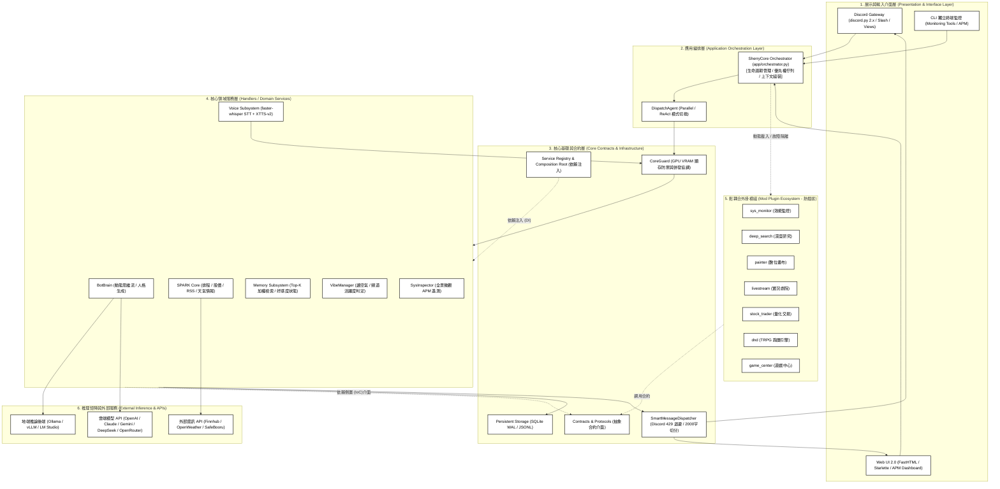
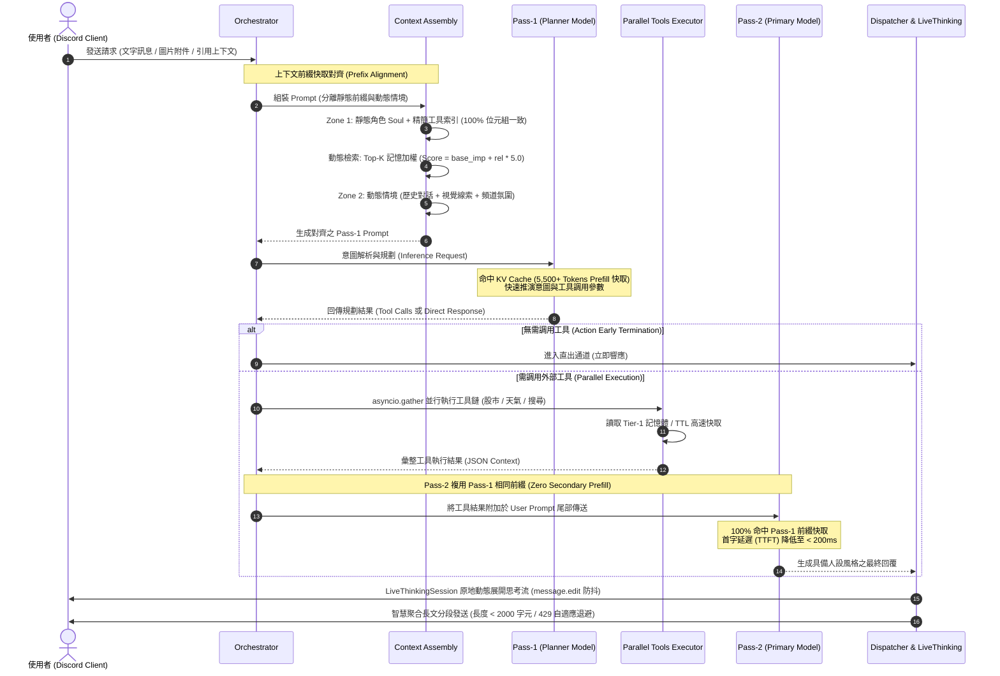
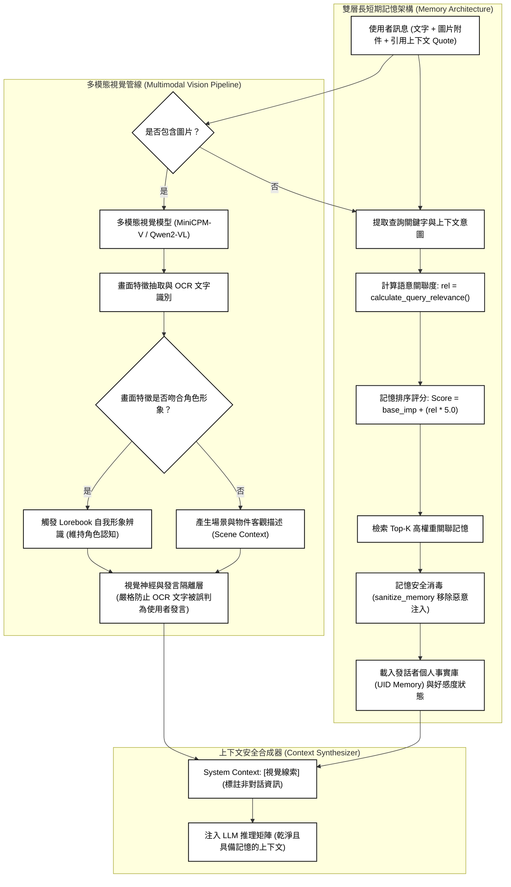
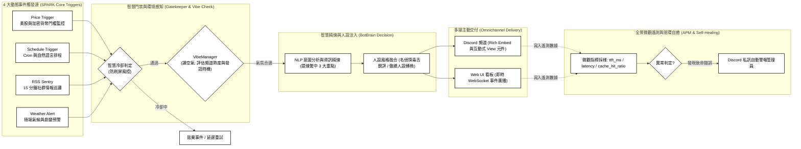

# 橘雪莉 (Sherry Platform) 履歷用架構與流程圖手冊 (黑白極簡專業版)

本手冊專為**正式履歷 (Resume)、PDF 列印、技術作品集 (Portfolio) 與技術面試簡報**設計。
風格採用**純白底、黑線條、黑文字（無彩色、無圖標 Emoji）**，具備最高印刷對比度與工程專業度。

---

## 目錄
1. **[架構圖 1] 系統總體分層解耦架構圖 (Clean Architecture System Topology)**
2. **[時序圖 2] Dual-Pass 雙階段推理與 KV Cache 前綴對齊管線 (Prefix-Caching-Aligned Dual-Pass Pipeline)**
3. **[流程圖 3] 多模態視覺感知與長期記憶隔離檢索系統 (Multimodal Vision & Memory Architecture)**
4. **[流程圖 4] SPARK 事件驅動自主情報推播閉環 (SPARK Event-Driven Autonomous Loop)**

---

## 1. 系統總體分層解耦架構圖 (Clean Architecture System Topology)

> **設計重點**：Clean Architecture 分層解耦、依賴倒置 (IoC)、Composition Root、模組熱插拔與 GPU 顯存併發防禦。

---

## 2. Dual-Pass 雙階段推理與 KV Cache 前綴對齊管線 (Prefix-Caching-Aligned Dual-Pass Pipeline)

> **設計重點**：Prompt Caching (KV Cache)、Zone 1/2 分離、Zero Secondary Prefill、TTFT < 200ms、asyncio.gather 並行調度。

---

## 3. 多模態視覺感知與長期記憶隔離檢索系統 (Multimodal Vision & Memory Architecture)

> **設計重點**：視覺神經與對話隔離防護（防止 OCR 文字誤判為群友對話）、Lorebook 自我形象辨識、動態加權記憶檢索演算法與 UID 記憶安全消毒。

---

## 4. SPARK 事件驅動自主情報推播閉環 (SPARK Event-Driven Autonomous Loop)

> **設計重點**：事件驅動架構 (EDA)、4 大動態觸發源、讀空氣 (Vibe Check) 頻率抑制、NLP 精煉與全景微觀 APM 遙測自癒。

---

## 履歷專案描述話術 (可直接複製進履歷)

- **系統架構設計 (Clean Architecture & IoC)**：
  - 「主導以 **Clean Architecture** 與 **IoC 依賴注入** 重構 AI 代理人核心，將排程調度、狀態管理與外部插件（10 大擴充模組）徹底解耦，透過單向契約防護將循環依賴降為 0，實現模組熱插拔與故障隔離。」
- **LLM 推理極限優化 (KV Cache Alignment & TTFT)**：
  - 「設計 **Zone 1 / Zone 2 前綴與動態內容分離架構**，確保 Pass-1 意圖規劃與 Pass-2 人格合成維持 100% 靜態前綴位元組一致；達成 **Zero Secondary Prefill**，使 Pass-2 首字延遲 (TTFT) 降低至 **< 200ms**，每輪對話節省 900+ Tokens。」
- **多模態安全與發言隔離 (Multimodal Isolation & Memory)**：
  - 「研發**視覺神經直出與發言隔離技術**，將多模態圖片 OCR 結果嚴格限定於 System Context，徹底消除大模型將圖片文字誤判為使用者發言的幻覺問題；結合 **Selective Top-K 加權演算法** 與 UID 記憶消毒機制，精準提取長期事實。」
- **事件驅動自主情報系統 (SPARK Event-Driven Engine)**：
  - 「構建 **SPARK 核心事件驅動推播系統**，支援價格異動、定期排程、RSS 資訊源與天氣預警等 4 大觸發源，配合自適應冷卻風控與讀空氣 (VibeManager) 機制，使 AI 具備主動發話與破冰能力。」
