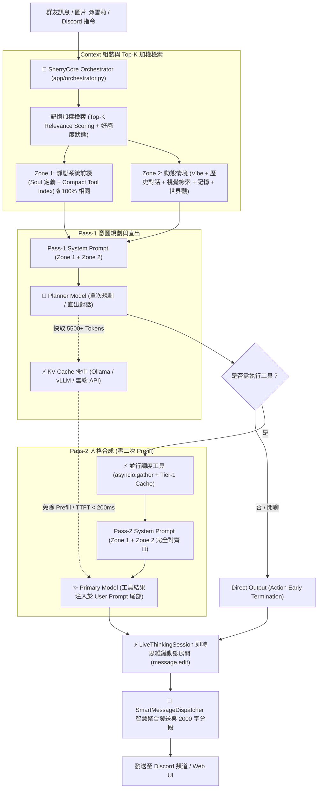

# 🧠 核心推理與 KV Cache 對齊架構 (Inference & Prefix Caching)

雪莉在推理核心採用 **「Zone 1 / Zone 2 前綴快取對齊架構」**，徹底解決雙階段 Agent 在 Pass-2 重複 Prefill 導致的高延遲與算力浪費問題：

### 核心技術亮點

1. **Zone 1 / Zone 2 前綴與動態內容分離 (Prefix Caching Alignment)**：
   - **Zone 1 (靜態系統前綴)**：包含 SOUL 角色核心定義、通用交互守則與精簡工具索引（Compact Tool Index），跨輪次保持 100% 位元組一致，最大化命中各大推理引擎的 Prompt Caching 機制。
   - **Zone 2 (動態情境)**：標準化順序（頻道氛圍 ➔ 歷史對話 ➔ 視覺線索 ➔ 當前發話者記憶 ➔ 世界觀事實 ➔ 時間戳記），緊貼生成點，完全不破壞前綴快取結構。
2. **Pass-1 與 Pass-2 靜態前綴 100% 嚴格對齊**：
   - Pass-1 與 Pass-2 共享 **100% 位元組一致的 System Prompt**。
   - Pass-2 直接命中 Pass-1 剛建立快取的 5,500+ tokens，免除二次 Prefill，Pass-2 TTFT 延遲降至 **< 200ms**！
3. **記憶系統檢索加權 (Selective Top-K Scoring)**：
   - 捨棄盲目定額注入，引入 `_calculate_query_relevance` 與 `_fact_rank_score = base_imp + (rel * 5.0)` 演算法，精準提取關聯記憶與好感度狀態。
4. **工具精簡與 Tier-1 TTL 快取**：
   - 將工具 Prompt 規則精簡約 900 tokens/turn，保留完整負向約束；股市與頻繁查詢加入 TTL 快取，大幅縮短端到端延遲。
