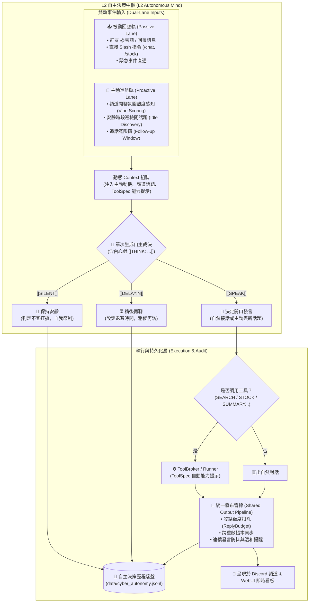
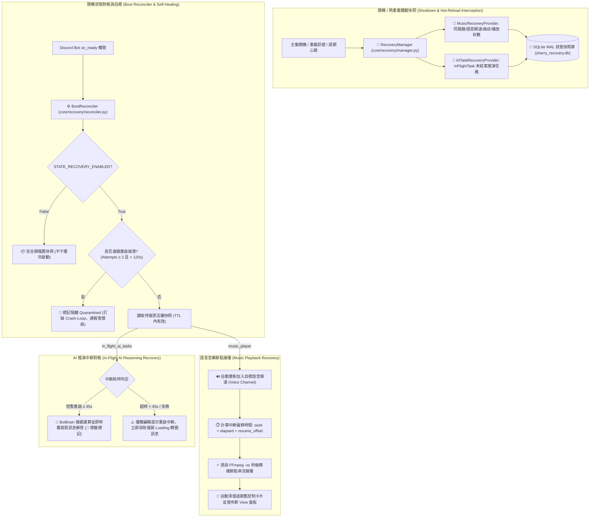
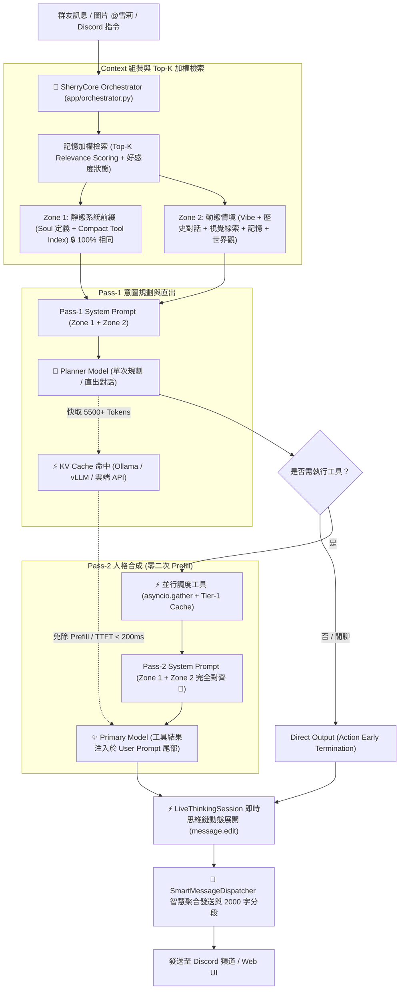

# 🤖 橘雪莉 — Discord AI Companion & Agent Platform (v1.10.0)

[](https://github.com/YuuuuutoOuO/Sherry-An-AI-Companion-Platform/actions/workflows/ci.yml)
[](LICENSE)

一個擁有獨立靈魂、會讀空氣、懂得自我反思、精通深度探研與數位藝術創作的 Discord 虛擬實況群友與全能 AI 代理人。  
基於 **discord.py 2.x** + **Sherry 微核心分層架構 (App / Core / Handlers / Mod)** + **8 大 LLM 推理引擎 (Ollama / LM Studio / vLLM / OpenRouter / OpenAI / Gemini / DeepSeek / Claude)** + **OneBrain-TwoLanes 雙軌架構** + **系統自癒與重啟復原框架 (Resilience & Recovery Framework)** + **asyncio 優先權佇列**，支援 Linux / Docker 容器化與 Windows 跨平台部署。具備 **L2 自主決策核心（說 / 安靜 / 晚點說）與內心戲歷史落盤**、**賽博群友 (Cyber Friend) v2 事件驅動引擎（追話寬限窗、連續訊息防抖、接話評分機制、影子模式）**、**次世代深色質感 Web 控制台 2.0 (Dark Cyber Aesthetic / Glassmorphism UI)**、**系統重啟狀態無痛自癒復原 (SQLite WAL 快照持久化、Crash-Loop 隔離防護、冪等開機對帳)**、**語音音樂播放斷點續播 (FFmpeg `-ss` 秒級接播、語音頻道自動重進、舊控制卡片清理)**、**未結案 AI 推演任務對帳 (熱重載自動續推、超時優雅除錯提示)**、**KV Cache 前綴嚴格對齊 (Prefix Caching)**、**全景組件效能監控與延遲微觀遙測 (APM)**、**條件觸發情報推播 (SPARK 核心)**、**視覺神經直出與發言隔離**、**即時動態思維鏈展開**、**地端深度研究**、**數位畫布創作**、**多元 Soul 人設與世界記憶** 與 **10 大擴充模組系統 (Mod System)**。

---

## ✨ 主要能力矩陣 (Core Capabilities)

| 類別 | 功能亮點 |
|---|---|
| 🤖 **L2 自主決策核心與內心戲 (L2 Autonomous Mind)** <br>`[v1.10 核心突破]` | **把「要不要開口」的決定權還給雪莉** · **模型自主裁決三種意圖** (`[[SPEAK]]` 正常發言 / `[[SILENT]]` 保持安靜 / `[[DELAY:N]]` 稍後再聊) · **自主動機動態寫入 Context** · **自主內心戲劇本 (`[[THINK: ...]]`) 與決策歷史落盤 (`data/cyber_autonomy.jsonl`)** · **連續發言與安靜自我節制與溫和提醒** |
| 👥 **OneBrain-TwoLanes 與賽博群友 v2 (Cyber Friend v2)** <br>`[v1.10 核心突破]` | **單一大腦雙軌並行 (被動回應軌 Passive Lane vs 主動巡航軌 Proactive Lane)** · **事件驅動核心架構** · **連續訊息防抖與接話評分動態計算** · **追話寬限窗 (Follow-up Window)** 避免常規對話被插話門檻卡死 · **影子模式 (Shadow Mode)** 供靜默觀察與沙盒測試 · **跨重啟聯絡帳本** 確保發話額度不因重啟歸零 |
| 🎨 **次世代深色質感 Web 控制台 (Dark Cyber WebUI 2.0)** <br>`[v1.10 核心升級]` | **全新主題樣式庫 (`theme.css`)** · **極致深色玻璃擬態 (Glassmorphism & Cyber Aesthetic)** · **全新雪莉去背形象看板娘** · **核心頁面全面重構** (側邊欄 Sidebar、頂部狀態列 Topbar、首頁儀表板 Dashboard、工作與自癒中樞 Tasks、毒舌吐槽 Roast、賽博群友 Care) · **自主決策卡片與內心戲動態檢視** · **PWA 離線快取適配** |
| 🛡️ **系統自癒與重啟復原 (Resilience & Recovery)** <br>`[v1.10 核心突破]` | **核心自癒框架 (`core/recovery/`)** · **高可用 SQLite WAL 狀態快照持久化 (`RecoveryStorage`)** · **開機自癒對帳引擎 (`BootReconciler`)** · **崩潰循環隔離防護 (Crash-Loop Protection，短時間連敗 ≥ 2 次自動隔離防重啟迴圈)** · **冪等單次對帳防護** · **`STATE_RECOVERY_ENABLED` 全域與 WebUI 線上切換** |
| 🎵 **語音音樂播放斷點續播 (Music Recovery)** <br>`[v1.10 核心突破]` | **音樂狀態快照提供者 (`MusicRecoveryProvider`)** · **重啟自動重新加入 Discord 語音頻道** · **FFmpeg `-ss` 精確秒數斷點續播** · **舊控制卡片動態偵測與清理銷毀** · **語音異常斷線自癒與 FFmpeg 行程即時釋放** |
| 🧠 **AI 推演對帳與中斷自癒 (AI Task Recovery)** <br>`[v1.10 核心突破]` | **進行中任務註冊中心 (`InFlightTaskRegistry`)** · **短暫重啟 (< 45s) 自動重算接續推演並原地覆寫解答** · **超時重啟 (> 45s) 優雅編輯消除殭屍 Loading 轉圈訊息** · **Semaphore 並發節流防風暴** · **自動修復與清除等待沙漏反應** |
| 🖥️ **工作與自癒中樞 (Task & Resilience Center)** <br>`[v1.10 核心升級]` | **Web 控制台「工作與自癒中樞」升級 (`/tasks`)** · **大腦即時推理佇列深度、優先級與延遲遙測** · **視覺化自癒狀態列 (提供者數量、有效與隔離快照統計、最近存檔時間)** · **進行中 AI 任務即時監控與快照防護** · **移除舊版 schedule.json 依賴** |
| ⚙️ **工具契約統一與動態提示 (Unified ToolSpec)** <br>`[v1.10 核心升級]` | **被動與主動軌道統一工具契約 (`ToolSpec`)** · **依據當前啟動策略自動產生工具能力提示與參數結構** · **修正 proactive tool runner 與結果長度上限截斷防護** |
| 🚀 **KV Cache & 推理極限最佳化** | **Zone 1 / Zone 2 前綴與動態內容分離架構** · **Pass-1 與 Pass-2 靜態前綴 100% 嚴格對齊 (Prefix Alignment)** · **免除二次 Prefill，Pass-2 TTFT 延遲降至 < 200ms** · **記憶加權 Top-K 評分檢索** · **精簡 Compact Tool Index 省下 900+ Tokens/turn** · **Tier-1 記憶體/股市 TTL 高速快取** |
| 🎼 **分層解耦架構 (Clean Architecture)** | **Orchestrator 抽離至應用層 (`app/orchestrator.py`) 解除循環依賴** · **Core 基礎層 (Contracts / DB / Guard / Recovery / Registry / State)** · **Handlers 核心業務 Cog** · **Mod 鬆耦合外掛** · **依賴倒置 (IoC) 與 Composition Root 客戶端注入** · **Import-Linter 邊界契約保護** |
| 🛡️ **全景效能監控與自我審查 (APM)** | **全景組件效能監控與健康哨兵 (`handlers/sys_inspector`)** · **微觀耗時遙測 (`ttft_ms` / `prefill_latency_ms` / `decode_latency_ms` / `cache_hit_ratio`)** · **`SYSTEM_INSPECT` 系統感知工具** · **`/self-monitoring` 延遲與品質稽核指令** · **Discord 私訊自動推播 ERROR 錯誤與系統警報至管理員** |
| ⚡ **條件觸發與情報推播 (SPARK Core)** | **SPARK 核心化升級 (`handlers/spark`) 全面接管傳統排程** · **4 大動態觸發器** (價格監控 `price` / 定期排程 `schedule` / RSS 資訊源 `rss` / 天氣劇變 `weather`) · **NLP 自然語言意圖解析** · **智慧冷卻與防過度推播** · **Web UI 專屬推播管理看板 (`spark.html`)** |
| 🧠 **智慧 Agent 架構 & 動態思維流** | **DispatchAgent 統合調度** · **LiveThinkingSession 即時動態編輯思考推演 (`message.edit` 零延遲防抖展開)** · **Parallel Agent** 單次規劃並行調度 · **ReAct Agent** 多輪推理工具鏈 · **Action Early Termination** 動作自適應秒結 · 複合指令自動拆解 · 自然語言 @Tag 回應 · 主動插話 (Interject) · 讀空氣 (VibeManager) |
| 👁️ **多模態視覺與發言隔離** | **多模態圖片深度解析 (`VISION_MODEL`) 直出對話** · **視覺神經感知與發言隔離架構 (徹底杜絕模型將圖片 OCR 內容誤判為群友發言)** · **跨模組自我形象辨識 (`⚠️自我辨識` Lorebook 觸發)** · **引用回覆上下文感知 (Quote Context)** |
| 🎭 **多元 Soul 人設生態與世界記憶** | **新增 Doro 人設、魔裁全系列角色、諾亞、漢娜、希羅等多款專屬 Soul 人設** · **頻道獨立 Soul 綁定 (`CHANNEL_SOUL_MAP`) 與即時熱切換** · **世界記憶 (`World Memory`) 與全域事實庫** · **UID 長期記憶物理消毒 (`sanitize_memory`)** |
| 🎛️ **現代化交互式 UI (Discord Views)** | **全面升級 Discord View/Button/Select 元件** · **音樂播放器互動控制面板 (`handlers/music/ui.py`)** · **D&D 跑團冒險操作面板 (`mod/dnd/views.py`)** · **實況劇院控制 UI** · **股市卡牌行情面板** · **`/execute` Command Hub 下拉式模組預覽中樞** |
| 🔬 **地端深度研究 (Deep Research)** | **10~30 分鐘級多輪自主深思推演** · **全網實時檢索與交叉文獻比對** · **批判性反思與論點自我驗證** · **論文級繁中學術報告生成** · **Web UI 專屬深度研究推演主控台** |
| 🎨 **藝術與創作工作室 (Creative Studio)** | **雪莉數位畫布繪圖引擎 (`mod/painter`)** (多筆刷系統 / 調色盤 / Gemma 多模態視覺臨摹 / 歷史畫廊) · Stable Diffusion 圖片生成 (`/draw`) · **實況劇院與大螢幕影音播放 (`mod/livestream`)** · YouTube 音樂串流 (`/play`) · 影片指定秒數轉 GIF (`/video`) |
| 💬 **毒舌銳評與吐槽 (Roast Engine)** | **關鍵字自動監聽與機率擲骰判定** · **雪莉名偵探毒舌銳評 / 傲嬌吐槽動態人設** · 頻道冷卻風控機制 · **Web UI 吐槽專屬管理看板 (`roast.html`)** (支援規則配置、風格切換與即時發送) |
| 🌐 **8 大 LLM 推理矩陣** | **全新支援 OpenRouter (`openrouter:`)** · **支援 FreeToken 雲端端點** · 本地主力 (**Ollama / LM Studio / vLLM**) · 雲端主力 (**OpenAI / Gemini / DeepSeek / Claude**) · ClientSession 連線池複用與動態前綴路由 |
| 🛠️ **全能工具與技能庫** | 台美股即時 K 線技術分析 (`/stock`) · 即時全網 RAG 搜尋 (`/search`) · Safebooru/Pixiv 搜圖 · 自然語言與 cron 定時排程提醒 (`/schedule`) · `/execute` 全能工具獨立測試與預覽 |
| 🔌 **10 大擴充模組系統 (Mod System)** | **10 大外掛模組熱插拔**：系統監控 (`sys_monitor`) · 深度研究 (`deep_search`) · 畫布工作室 (`painter`) · 實況劇院 (`livestream`) · AI 社群哨兵 (`feed_sentinel`) · 美股虛擬量化交易 (`stock_trader`) · D&D 跑團 (`dnd`) · 小遊戲遊樂場 (`game_center`) · 股市卡價追蹤 (`market_plugin`) · 影片 GIF (`video_clipper`) |
| 🔊 **語音系統與底層守護** | Discord 語音通話 · faster-whisper STT 語音辨識 · XTTS-v2 聲音克隆 TTS · Silero VAD 語音活動檢測 · **FFmpeg 行程即時釋放與防洩漏機制** · **語音異常斷線自動重連與自癒** |
| 🖥️ **Web 控制台 2.0** | **全域設定線上熱編輯** (支援線上編輯 `.env` 與 `settings.py` 常數、需重啟標記、搜尋與一鍵還原) · **頂部全景 APM 健康總覽看板** · **工作與自癒中樞** · **13 大模組看板** |
| 🛠️ **獨立終端監控工具** | **`tools/` 專用運維套件**：大腦佇列監控 (`monitor_brain.py`) · 情報哨兵即時追蹤 (`monitor_sentry.py`) · Web UI 狀態監控 (`monitor_web.py`) |
| 🛡️ **資安與顯存協調** | **GPU 顯存 (VRAM) 併發衝突協調 (`CoreGuard`)** · **Discord API 429 編輯速率限制防抖自適應退避** · **管理員登入與操作歷史審計 (`./data/admin_audit.jsonl`)** · IP 暴力破解防禦鎖定 · 時序攻擊防禦 · XSS 防護 |
| 🐧 **容器與跨平台** | **Linux / Docker 容器化完整支援** · **`0.0.0.0` 綁定自動降級** · **`.bat` / `.sh` 跨平台快速啟動與重啟腳本 (`start_sherry_tabs.bat` / `open_web_ui.bat`)** |

---

## 👥 OneBrain-TwoLanes 與 L2 自主性架構 (OneBrain-TwoLanes & L2 Autonomous Architecture)

雪莉在 V1.10.0 正式確立了 **「L2 具身自主性 (Embodied L2 Autonomy)」** 與 **「OneBrain-TwoLanes (單一大腦、雙軌並行)」** 架構。打破傳統聊天機器人「被問才答」的單向被動模式，將群組互動劃分為 **被動回應軌 (Passive Lane)** 與 **主動巡航軌 (Proactive Lane)**，兩軌共享同一認知大腦、記憶與工具體系，並將「要不要開口」的最高決定權完整交還給雪莉：



### 核心技術亮點

1. **L2 自主決策（說 / 安靜 / 晚點說）**：
   - 程式護欄僅負責判定「什麼時候可以考慮開口」，而「要不要發言」的決定權由雪莉根據當前氛圍、自身動機與對話歷史自行判斷。
   - 嚴格指令協定：雪莉可輸出 `[[SILENT]]` 選擇閉嘴、`[[DELAY:N]]` 延後考慮，或輸出正常對話，完全不產生死板的罐頭自言自語。
2. **自主內心戲劇本 (`[[THINK: ...]]`) 與決策歷史落盤**：
   - 雪莉在決定是否開口前，會在思考區塊展開自主動機與心理活動（僅消耗 20~60 tokens），並非同步保存至 `data/cyber_autonomy.jsonl`，便於管理者在 WebUI 洞察她的心智歷程。
3. **OneBrain-TwoLanes 雙軌共融架構**：
   - 被動回應軌（Tag、Mention、Slash）與主動巡航軌（賽博群友 v2、定時探討）共用統一記憶體庫、好感度帳本與輸出過濾管線。
   - **追話寬限窗 (Follow-up Window)**：在群友剛剛熱烈互動後自動開啟寬限，避免常規延續對話被插話冷卻門檻阻擋。
4. **工具契約統一化 (`ToolSpec`)**：
   - 解決過往主動回合 runner 介面不一致問題，統一由 `ToolSpec` 依據啟動策略動態生成能力說明，杜絕手寫 Prompt 漂移與幻覺。

---

## 🛡️ 系統自癒與重啟復原架構 (Resilience & Recovery Architecture)

雪莉在 V1.10.0 正式確立了工業級的 **「系統自癒與重啟復原框架 (Resilience & State Recovery Framework)」**。系統在面臨熱重載（Hot Reload）、例行重啟、版本升級或非預期崩潰時，能夠將運作狀態進行原子化快照保存，並於系統 Ready 時精準對帳接續，提供宛如未曾中斷的零感知自癒體驗：



### 四大自癒核心支柱

1. **高可用 SQLite WAL 狀態快照儲存庫 (`RecoveryStorage`)**：
   - 採用獨立 SQLite 資料庫 (`data/sherry_recovery.db`) 搭配 **Write-Ahead Logging (WAL)** 模式，兼具極致併發讀寫效能與崩潰安全保證。
   - 支援 TTL 存活時效管理、復原嘗試次數追蹤、隔離狀態標記與全域非同步抽象封裝。
2. **防崩潰循環與冪等開機對帳 (`BootReconciler`)**：
   - **崩潰循環防護 (Crash-Loop Protection)**：若同一模組快照在 120 秒內連續嘗試恢復失敗達 2 次，系統自動標記 `quarantined=1` 進行安全隔離，堅決杜絕因惡意音訊或毒藥任務導致主程式無限重啟死循環。
   - **單次對帳防護 (Idempotency Guard)**：嚴格限制 `on_ready` 僅執行一次對帳，防範 Discord 網路震盪重複觸發；同時支援熱重載手動強制重置 (`force=True`)。
3. **語音音樂播放斷點續播 (`MusicRecoveryProvider`)**：
   - 記錄各伺服器語音頻道 ID、文字頻道 ID、當前曲目、播放起點時間戳記與後續播放佇列。
   - 重啟後背景非同步重新連回 Discord 語音頻道，透過 FFmpeg `-ss {seek}` 達成秒級精準斷點接播。
   - 自動偵測並刪除伺服器中殘留的舊播放器控制卡片，發布全新互動 View 控制卡片，杜絕殭屍按鈕失效。
4. **未結案 AI 推演任務對帳 (`AITaskRecoveryProvider`)**：
   - 即時追蹤 `InFlightTaskRegistry` 中正在運算之對話任務與佔位訊息。
   - **短暫重啟 (≤ 45s)**：自動調用大腦進行接續推理，透過 `_chunk_message` 分段並原地覆寫原 Loading 訊息，補齊 `🔄`、`📌`、`🗑️` 互動反應與意圖稽核。
   - **超時重啟 (> 45s)**：優雅編輯原訊息提示使用者系統曾短暫重啟，消除永遠轉圈的殭屍訊息，並自動移除使用者的沙漏等待反應。

---

## 🧠 核心推理與 KV Cache 對齊架構 (Inference & Prefix Caching)

雪莉在推理核心採用 **「Zone 1 / Zone 2 前綴快取對齊架構」**，徹底解決雙階段 Agent 在 Pass-2 重複 Prefill 導致的高延遲與算力浪費問題：



### 核心技術亮點

1. **Zone 1 / Zone 2 前綴與動態內容分離 (Prefix Caching Alignment)**：
   - **Zone 1 (靜態系統前綴)**：包含 SOUL 角色核心定義、通用交互守則與精簡工具索引（Compact Tool Index），跨輪次保持 100% 位元組一致，最大化命中各大推理引擎的 Prompt Caching 機制。
   - **Zone 2 (動態情境)**：標準化順序（頻道氛圍 ➔ 歷史對話 ➔ 視覺線索 ➔ 當前發話者記憶 ➔ 世界觀事實 ➔ 時間戳記），緊貼生成點，完全不破壞前綴快取結構。
2. **Pass-1 與 Pass-2 靜態前綴 100% 嚴格對齊**：
   - Pass-1 與 Pass-2 共享 **100% 位元組一致的 System Prompt**。
   - Pass-2 直接命中 Pass-1 剛建立快取的 5,500+ tokens，免除二次 Prefill，Pass-2 TTFT 延遲降至 **< 200ms**！
3. **記憶系統檢索加權 (Selective Top-K Scoring)**：
   - 捨棄盲目定額注入，引入 `_calculate_query_relevance` 與 `_fact_rank_score = base_imp + (rel * 5.0)` 演算法，精準提取關聯記憶與好感度狀態。
4. **工具精簡與 Tier-1 TTL 快取**：
   - 將工具 Prompt 規則精簡約 900 tokens/turn，保留完整負向約束；股市與頻繁查詢加入 TTL 快取，大幅縮短端到端延遲。

---

## 🚀 快速開始

### 環境需求

- **作業系統**：Windows 10/11 或 Linux (Ubuntu 20.04+ / Debian 11+ / Docker)
- **Python**：3.10 ~ 3.12
- **推論後端**：[Ollama](https://ollama.com) / LM Studio / vLLM 本地運行中（或外部 OpenAI / Gemini / DeepSeek / Claude / OpenRouter API Key）
- **多媒體支援**：FFmpeg（音樂串流、斷點續播與 GIF 轉檔需用）
- **GPU 算力**（建議）：NVIDIA CUDA GPU（供語音 STT/TTS、本地大模型與 Stable Diffusion 圖片生成）

### 安裝步驟

```bash
# 1. 複製專案
git clone https://github.com/YuuuuutoOuO/Sherry-An-AI-Companion-Platform.git
cd Sherry-An-AI-Companion-Platform

# 2. 建立並啟用虛擬環境
python -m venv .venv
.venv\Scripts\activate          # Windows
# source .venv/bin/activate     # Linux / Docker

# 3. 安裝相依套件
pip install -r requirements.txt
```

### 設定 `.env`

於專案根目錄建立 `.env` 檔案，範例如下：

```env
# ── Discord 必要設定 ──────────────────────────────────────
DISCORD_BOT_TOKEN=你的_DISCORD_BOT_TOKEN
ADMIN_USER_IDS=[425311733503229972]

# ── 系統自癒與重啟復原核心開關 (v1.10 全新支援) ────────────
STATE_RECOVERY_ENABLED=True       # 是否啟用重啟狀態自癒與斷點續播 (預設 True)

# ── Agent 架構與調度模式 ─────────────────────────────────
AGENT_DISPATCH_MODE=PARALLEL      # PARALLEL (預設並行) | REACT (多步推理) | CLASSIC (傳統)
ACTION_EARLY_TERMINATION_ENABLED=True
LIVE_THINKING_EDIT=True           # 是否啟用 Discord 原地動態思維鏈展開

# ── 本地 LLM 後端 Base URLs ──────────────────────────────
OLLAMA_BASE_URL=http://localhost:11434
LMS_BASE_URL=http://localhost:1234/v1
VLLM_BASE_URL=http://localhost:8000/v1

# ── 雲端 API Keys (選填，填入即解鎖對應雲端模型) ─────────
OPENAI_API_KEY=
GEMINI_API_KEY=
DEEPSEEK_API_KEY=
CLAUDE_API_KEY=
OPENROUTER_API_KEY=

# ── 工具 API Keys (選填) ──────────────────────────────────
OPENWEATHERMAP_API_KEY=          # 天氣查詢
FINNHUB_API_KEY=                 # 美股即時報價與技術指標

# ── Web 控制台安全性設定 ─────────────────────────────────
WEB_UI_PASSWORD=sherry123        # Web UI 管理員登入密碼 (帳號預設為 admin)
WEB_UI_PORT=8763
WEB_UI_HTTPS=True
```

### 拉取常用模型

```bash
# 對話與推理模型 (Ollama)
ollama pull krith/mistral-nemo-instruct-2407-abliterated:IQ4_XS
ollama pull qwen2.5:3b

# 視覺辨識模型 (多模態圖片理解)
ollama pull minicpm-v
# 或 ollama pull qwen2-vl-7b-instruct
```

### 啟動雪莉

* **Windows**:
  ```bash
  python main.py
  # 或直接雙擊 start_sherry_tabs.bat / restart_sherry.bat
  ```
* **Linux / Docker**:
  ```bash
  chmod +x restart_sherry.sh update_and_restart.sh
  ./restart_sherry.sh
  ```

啟動完成後，可開啟瀏覽器造訪 Web 後台控制台（或雙擊 `open_web_ui.bat` / `open_browser.bat`）：  
🔗 **[https://localhost:8763](https://localhost:8763)**  
（預設帳號：`admin`，密碼：同 `.env` 中之 `WEB_UI_PASSWORD`）

---

## 🔌 10 大擴充模組系統 (Mod System)

雪莉採用鬆散耦合的 Plugin 架構，系統於啟動時自動掃描 `./mod/` 目錄下所有包含 `cog.py` 的子資料夾並嘗試載入。**任一插件出錯絕不影響雪莉核心運作！**

```text
mod/
├── sys_monitor/     # 📊 系統效能診斷與低干擾記憶體採樣監控
├── deep_search/     # 🔬 地端 LLM / SLM 多輪自主深度研究主控台
├── painter/         # 🎨 雪莉數位畫布繪圖引擎與多筆刷調色盤
├── livestream/      # 📺 實況劇院與大螢幕影音播放系統
├── feed_sentinel/   # 📰 AI 社群情報哨兵與主動話題探勘
├── stock_trader/    # 📈 雪莉美股虛擬量化交易系統
├── video_clipper/   # 🎬 YouTube 影片轉 GIF 動圖製作工具
├── dnd/             # 🎲 D&D TRPG AI 地下城主跑團遊戲引擎
├── game_center/     # 🎮 小遊戲遊樂場 (21點/猜拳/踩地雷/海龜湯/AI對弈)
└── market_plugin/   # 📊 股市技術晨報、AI晚報、PTCG卡價與ETF溢折價
```

### 模組詳細介紹與指令清單

#### 1. 📊 `sys_monitor` — 系統效能診斷與採樣監控
- **功能**：高頻記憶體緩衝採樣（CPU、RAM、NVIDIA GPU 負載/溫度/VRAM、硬碟、雪莉進程 CPU 與記憶體 RSS、磁碟寫入），每 30 秒批次落盤單行 JSONL，達到零頻繁開關檔的極致低干擾。
- **指令與 Web 支援**：
  - `/sys_status`：在 Discord 即時顯示伺服器硬體與主程式資源狀態 Embed。
  - **Web UI 效能監控面板 (`sys_monitor.html`)**：提供動態時間序列折線圖與健康狀態診斷。

#### 2. 🔬 `deep_search` — 深度研究主控台
- **功能**：支援 10~30 分鐘級地端 LLM / SLM 多輪自主思考推演、全網搜尋、文獻精讀、批判性反思與論文級研究報告產出，並可在 Web UI 即時觀看思考進度與思維樹！
- **指令**：
  - `/deep_search query:<研究主題> depth:<深/淺>`：發起深度研究任務。

#### 3. 🎨 `painter` — 畫畫工作室 (數位畫布繪圖引擎)
- **功能**：雪莉專屬數位畫布繪圖引擎 (`VirtualCanvas`)、多筆刷系統 (`BrushEngine`)、調色盤管理 (`PaletteManager`)、指令直譯器 (`CommandInterpreter`)，支援 Gemma 多模態視覺臨摹、歷史畫廊與自定義手繪生成。

#### 4. 📺 `livestream` — 實況劇院與影音播放
- **功能**：支援 Discord 點播 YouTube 與本地影片至實況大螢幕（獨立伺服器 PORT 8764），具備選集連播、現代化 View 控制介面與播放器伺服器。

#### 5. 📰 `feed_sentinel` — AI 社群情報哨兵 & 主動話題探勘
- **功能**：每日 08:00~23:00 每 15 分鐘自動巡邏 RSS/情報來源，自動去重並由 BotBrain 提煉 3 點繁中重點與雪莉犀利銳評，主動推播至 Discord 頻道，解決群組冷場！
- **指令**：
  - `/sentinel_fetch`：手動立即觸發情報哨兵抓取與推播。

#### 6. 📈 `stock_trader` — 雪莉美股虛擬量化交易系統
- **功能**：自帶 $10,000 美金虛擬本金，美股交易時段 (台灣時間 23:00~04:00) 自動巡邏，03:50 臨關盤強制看盤。結合 AI 策略分析師 (`TradeStrategist`) 與演算法交易員 (`AlgoTrader`) 執行自動交易與風控，成交自動推播至頻道。
- **指令與 Web 支援**：
  - `!stock_status`：查看當前美股持倉、資產淨值與收益率。
  - **Web UI 炒股專屬看板**：提供視覺化未實現損益、AI 交易決策思路日誌、一鍵「刷新行情損益」與「手動評估看盤」。

#### 7. 🎬 `video_clipper` — YouTube 影片轉 GIF 動態截取
- **功能**：快速將 YouTube 指定時間片段轉換為高畫質 GIF 動圖發送至頻道。
- **指令**：
  - `/video url:<網址> start_time:<開始時間> end_time:<結束時間>`  
    *範例：`/video url:https://youtu.be/xxx start_time:1:30 end_time:1:45`*

#### 8. 🎲 `dnd` — D&D TRPG AI 地下城主跑團遊戲引擎
- **功能**：完整整合地下城主 AI (DM)、角色卡、屬性骰判定 (優勢/劣勢)、互動式 Discord View 按鈕面板與動態世界模擬。
- **指令**：
  - `/dnd_join`：創建專屬 D&D 冒險者角色卡。
  - `/dnd_session`：開啟/關閉本頻道的 D&D 自動遊戲模式。
  - `/dnd_action`：向 DM 提出冒險動作描述。
  - `/dnd_roll`：進行 D&D 擲骰判定 (支援 d20, d6, 優勢/劣勢)。
  - `/dnd_status`：查看角色卡狀態與生命值。
  - `/dnd_inventory`：查看背包裝備與物品。
  - `/dnd_world`：查看世界時間與陣營勢力狀態。

#### 9. 🎮 `game_center` — 小遊戲遊樂場
- **功能**：支援 21 點撲克 (`blackjack`)、猜拳大對決 (`rps`)、踩地雷 (`minesweeper`)、海龜湯 (`turtle_soup`)、井字棋 (`tic_tac_toe`)、密室逃脫 (`escape_room`)，並結合地端 LLM 進行雪莉名偵探個性對弈與調侃！

#### 10. 📊 `market_plugin` — 股市與卡價追蹤
- **功能**：技術指標晨報 (08:00)、Gemini AI 晚間分析 (21:30)、PTCG 卡片即時報價 (10:00)、ETF 溢折價監控 (盤中每 10 分鐘)。具備互動式 View 操作面板。
- **指令**：
  - `/market_raw` / `!raw`：手動產出技術指標報告。
  - `/market_add` / `/market_remove` / `/market_list`：股票追蹤清單管理。
  - `/card_add` / `/card_remove` / `/card_list` / `/card_update`：PTCG 卡片追蹤與爬蟲更新。

---

## 💬 常用核心互動與指令指南

雪莉全面支援 **自然語言對話** 與 **Discord 斜線指令 (`/`)** 雙軌並行：

```text
@雪莉 幫我播 Yoasobi 的 Idol，順便找一張雪莉的可愛圖片！   # 複合指令自動拆解並行處理
@雪莉 查一下 2330 走勢與最新新聞                          # 即時網頁 RAG + 台股 K 線
@雪莉 10分鐘後提醒我出門                                  # SPARK 核心自然語言排程
@雪莉 (夾帶圖片) 妳覺得這張圖好看嗎？                      # 視覺神經直出 + 發言隔離自我認知
```

| 類別 | 指令 / 操作 | 說明 |
|---|---|---|
| 📖 **全能幫助** | `/help` | 叫出 Discord Select Menu 分類式全功能指南 |
| 🛡️ **自癒與系統重啟** | `/restart` · `/reload` | 觸發優雅快照保存並執行模組/核心重啟對帳自癒 |
| 🛡️ **系統自我感知** | `/self-monitoring` | 顯示大腦微觀耗時遙測、品質審查度量與 APM 健康指標 |
| 📊 **系統硬體監控** | `/sys_status` | 即時顯示 CPU / RAM / GPU / 雪莉主程式資源佔用 Embed |
| 💬 **指揮中心** | `/execute intent:<TOOL> query:<內容>` | Command Hub 互動選單預覽各模組面板或強制執行特定工具 |
| ⚡ **SPARK 條件推播** | `/spark_add` · `/spark_list` · `/spark_toggle` | 管理價格、RSS、天氣與排程等條件觸發推播規則 |
| 🎵 **留聲機音樂** | `/play` | 播放音樂並呼叫全功能互動式 View 控制器（支援斷點續播） |
| 🎤 **語音通話** | `/join_voice` · `/leave_voice` | 讓雪莉加入/離開目前語音頻道進行即時語音交談 |
| 🧠 **記憶管理** | `/memory_show` · `/memory_clear` | 查看或清除雪莉對自己的長期記憶檔案 (僅自己可見) |
| 👥 **氛圍感知** | `/vibe_show` · `/vibe_clear` | 查看或重設頻道當前熱門話題與氛圍狀態 |
| ⚙️ **系統維運** | `/stats` · `/config` | 查看系統統計儀表板與伺服器端配置 |

---

## 🖥️ Web UI 視覺化控制台 2.0

雪莉內建基於 **Quart** 的高質感現代化 Web 管理後台 (`https://localhost:8763`)，包含以下 14 大核心分頁與設定管理：

1. **📊 總覽主控台 (Dashboard)**：實時監控 CPU / GPU / RAM / 網路資源，精確比對「🤖 運作中的雪莉 Commit」與「📦 本地最新 Git 代碼」，頂部整合 **全景 APM 健康總覽看板** 與 **自癒監控狀態**，支援一鍵 Git Pull + 重啟更新。
2. **⚙️ 全域設定線上熱編輯 (Settings Management)**：直接在後台即時修改 `.env` 與 `settings.py` 常數（支援 `STATE_RECOVERY_ENABLED`、清單動態編輯、需重啟標記、即時搜尋過濾與一鍵還原預設值）。
3. **⏰ 工作與自癒中樞 (Task & Resilience Center)** `[v1.10 全新升級]`：
   - **大腦即時推理佇列 (LLM Task Queue)**：掌握即時推演佇列深度、任務優先級 (Priority)、序號與推演文字預覽。
   - **進行中 AI 推理任務 (Active AI Tasks)**：監控正處於思維鏈推演、工具調用中的對話任務，展示已推演秒數、目標頻道、訊息 ID 與快照保護狀態。
   - **核心自癒狀態列 (State Recovery Summary)**：頂部橫幅呈現自癒開關狀態（🟢 運作中 / ⚪ 已停用）、已註冊提供者數量、有效快照數、隔離快照數與最近快照存檔時間，支援 3 秒動態自動輪詢。
   - **全面移除舊版 schedule.json 監控**，由 SPARK 核心與自癒框架全面接管。
4. **📋 即時日誌 (Live Logs)**：支援依事件類型 (CHAT, 插話, ERROR) 與分頁過濾，具備 Guest 日誌白名單防護。
5. **💻 系統資源 (System Metrics)**：硬體資源即時動態圖表 (Chart.js)。
6. **💬 雪莉測試室 (Chat Playground)**：免開 Discord 直接在瀏覽器與雪莉對話，支援視覺化展開 ReAct / Parallel 思考過程標籤與 Tool Invocation。
7. **📡 地端 AI 服務 (Local AI Monitor)**：每 5 秒自動診斷 Ollama (`11434`)、LM Studio (`1234`)、vLLM (`8000`)、Stable Diffusion (`7860`) 之連線狀態、Ping 延遲與掛載模型。
8. **⚡ SPARK 條件推播看板 (Spark Manager)**：視覺化觸發器清單、即時手動檢查觸發、支援價格/RSS/天氣/排程條件設定。
9. **📈 系統效能診斷 (Sys Monitor)**：獨立高頻時間序列採樣歷史圖表，掌握雪莉進程資源佔用與 GPU 溫度變化。
10. **🔬 深度研究控制台 (Deep Research)**：即時查看多輪深度主題研究推演進度、檢索來源與論文級報告成果。
11. **🎨 畫畫工作室 (Painter Studio)**：視覺化畫布預覽、筆刷調色盤即時調試與雪莉歷史創作畫廊。
12. **💬 雪莉吐槽管理 (Roast Manager)**：關鍵字監聽規則配置、命中機率與冷卻調節、名偵探吐槽風格切換與即時測試。
13. **📈 雪莉虛擬炒股 (Stock Trader)**：即時美股持倉、未實現損益、AI 決策歷程看板，支援一鍵手動評估看盤。
14. **🛡️ 管理員審計 (Admin Audit Log)**：完整記錄登入 IP、來源網路標籤 (Localhost / Radmin / LAN)、裝置作業系統與各項操作時間軸歷程。

---

## 📁 專案目錄結構

```text
Sherry-An-AI-Companion-Platform/
├── app/                   # 🎼 SherryCore 應用層協調者 (Orchestrator：請求調度與能力分配)
├── core/                  # 🧱 基礎架構層 (Clean Architecture)
│   ├── recovery/          # 🛡️ 系統狀態快照、開機自癒對帳與 SQLite WAL 儲存庫
│   ├── contracts.py       # 協定介面與抽象定義
│   ├── db.py              # 集中式資料庫連線池與 WAL Checkpoint 管理
│   ├── guard.py           # 安全守衛、速率限制與 VRAM 顯存協調
│   ├── registry.py        # 雙層能力註冊表
│   └── state.py           # 即時心智狀態快照
├── data/                  # 儲存資料庫、JSONL 日誌、自主決策歷程 (cyber_autonomy.jsonl) 與自癒快照庫
├── file/                  # 人設定義 (AI_personality.py) 與 Soul 人格檔 (sherry_default.md 等)
├── handlers/              # 核心業務邏輯 (Cog Extensions)
│   ├── admin/             # 管理員指令與伺服器設定
│   ├── bot_brain/         # 大腦推理引擎、優先權佇列與健康檢查
│   ├── care/              # 👥 賽博群友與主動關懷模組
│   │   ├── cyber/         # 🧠 賽博群友 v2 事件驅動引擎、L2 自主決策核心與政策閘門
│   │   └── web.py         # 賽博群友 WebUI 後端端點
│   ├── executor/          # /execute 指令中樞預覽版 (Command Hub)
│   ├── heartbeat/         # 心跳定時主動任務
│   ├── sys_inspector/     # 🛡️ 系統監控 Cog：健康哨兵、微觀延遲遙測與 /self-monitoring
│   ├── memory/            # 長期記憶萃取、記憶物理消毒、加權 Top-K 評分與世界記憶
│   ├── music/             # 留聲機音樂播放引擎、View 控制卡片與自癒斷點續播提供者
│   ├── roast/             # 雪莉毒舌銳評與吐槽子系統
│   ├── spark/             # ⚡ SPARK 條件觸發與排程推播核心系統（全面接管排程）
│   ├── social/            # DispatchAgent 調度器、LiveThinking、AI 推演自癒對帳與工具庫
│   │   ├── actions/       # 動作定義與執行器
│   │   ├── tools/         # Chat, Draw, Image, Music, Schedule, Search, Stock 工具庫
│   │   ├── tool_specs.py  # ⚙️ 統一工具規格 (ToolSpec) 與動態提示自動生成
│   │   ├── recovery_provider.py # AI 推演任務中斷自癒對帳
│   │   └── task_registry.py     # 進行中 AI 任務註冊中心
│   ├── vibe_manager/      # 頻道熱門話題與氛圍追蹤
│   ├── voice/             # 語音通話 (STT / TTS / VAD / FFmpeg 自癒)
│   ├── web_explorer/      # 網頁內容檢索與提取
│   ├── help_cog.py        # /help 分類幫助選單
│   └── welcome_cog.py     # 新人加入動態歡迎
├── mod/                   # 10 大擴充外掛模組 (可插拔)
│   ├── sys_monitor/       # 📊 系統資源採樣與效能診斷監控
│   ├── deep_search/       # 🔬 地端 LLM / SLM 深度研究主控台
│   ├── painter/           # 🎨 雪莉數位畫布繪圖引擎與工作室
│   ├── livestream/        # 📺 實況劇院與影音播放系統
│   ├── feed_sentinel/     # 📰 AI 社群情報哨兵
│   ├── stock_trader/      # 📈 美股虛擬量化交易系統
│   ├── video_clipper/     # 🎬 YouTube 轉 GIF 工具
│   ├── dnd/               # 🎲 D&D TRPG 跑團系統
│   ├── game_center/       # 🎮 小遊戲遊樂場
│   └── market_plugin/     # 📊 股市與卡價追蹤
├── tools/                 # 🛠️ 獨立終端監控運維工具 (monitor_brain, monitor_sentry, monitor_web)
├── web_ui/                # Quart Web 管理後台 (HTML/CSS/JS)
│   ├── static/theme.css   # 🎨 次世代深色毛玻璃質感主題樣式庫
│   └── templates/         # 儀表板、工作自癒、賽博群友、吐槽等現代化視圖
├── Docs/                  # 專案詳細技術架構與歷史版本文件存檔
├── main.py                # 程式主入口
├── settings.py            # 全域設定中心
└── requirements.txt       # Python 相依套件清單
```

---

## 📋 v1.10.0 更新日誌 (Release Notes)

### 🤖 1. L2 自主決策核心與自主內心戲 (L2 Autonomous Mind & Self-Drama)
- **自主決策權回歸**：程式僅判定「何時可以考慮開口」，由雪莉模型自行在單次生成中決定意圖（`[[SPEAK]]` 發言、`[[SILENT]]` 保持安靜、`[[DELAY:N]]` 稍後再聊），消弭機械式定時強行插話。
- **自主內心戲劇本 (`[[THINK: ...]]`)**：每次決策前在思考區塊產生內心小劇場，並即時非同步寫入 `data/cyber_autonomy.jsonl`，保留最近 500 筆自主決策軌跡供 WebUI 動態檢視。
- **動態動機寫入 Context**：把「為什麼這一輪考慮開口（如：安靜太久、熱聊想湊一腳）」寫進動態 Context，使雪莉理解自己的行為動機。
- **自我節制與溫和提醒**：當連續發話或連續保持安靜時，系統提供溫和的自我調節提示，促使發言節奏自然協調。

### 👥 2. OneBrain-TwoLanes 架構與賽博群友 v2 (Cyber Friend v2)
- **單一大腦雙軌共融**：被動回應軌（Tag、Mention、Slash）與主動巡航軌（賽博群友 v2）徹底收斂為同一心智核心，共享世界記憶、好感度狀態與工具池。
- **追話寬限窗 (Follow-up Window)**：在群友剛剛熱烈互動後自動開啟寬限，避免常規延續對話被插話冷卻門檻阻擋。
- **連續訊息防抖與接話評分**：引入語境熱度與接話價值評分，動態評估是否值得插話，有效過濾無意義群聊洗版。
- **跨重啟聯絡帳本**：發話額度（ReplyBudget）改為跨重啟持久化追蹤，杜絕因服務重啟導致發話配額被重置或濫用。
- **影子模式 (Shadow Mode)**：支援在不公開發言的情況下靜默觀察沙盒頻道事件與對話決策，大幅降低測試干擾。

### 🎨 3. 次世代深色質感 Web 控制台 2.0 (Dark Cyber Aesthetic & Glassmorphism UI)
- **全新現代主題樣式庫 (`theme.css`)**：全面導入深色毛玻璃（Glassmorphism）、微發光動態陰影、優雅字體階層與現代 CSS 變數設計。
- **核心視圖全面重構**：
  - **側邊欄 (Sidebar) & 頂部狀態列 (Topbar)**：全新去背雪莉看板娘形象、整合在線狀態微光指示與直覺功能導航。
  - **首頁儀表板 (Dashboard)**：系統負載、記憶體、GPU 顯存與推理即時狀態卡片重新佈局。
  - **工作與自癒中樞 (Tasks)**：結合大腦即時推演佇列與 SQLite WAL 自癒狀態總覽。
  - **賽博群友專區 (Care)**：新增自主狀態即時卡片、內心戲檢視抽屜與雙軌在線參數熱配置。
- **PWA 離線快取適配**：升級 Service Worker 快取策略，有效杜絕靜態資產版本快取衝突。

### ⚙️ 4. 工具契約統一化與自動能力提示 (ToolSpec & Unified Capability Hints)
- **`ToolSpec` 單一事實來源**：將被動與主動軌道的所有工具介面、別名與參數契約收斂至 `handlers/social/tool_specs.py`。
- **動態能力提示生成**：工具說明由 `ToolSpec` 根據當前啟動策略自動產生，杜絕手寫 Prompt 漂移與模型協議認知偏差。
- **Proactive Runner 修復**：修復主動回合工具呼叫接錯 Runner 的問題，並加入輸出長度上限截斷防護。

### 🛡️ 5. 系統自癒與重啟復原框架 (System Resilience & Recovery Framework)
- **核心架構落地 (`core/recovery/`)**：實現抽象可恢復介面 `Recoverable`、快照協調管理器 `RecoveryManager` 與開機自癒對帳引擎 `BootReconciler`。
- **高可用 SQLite WAL 快照持久化 (`RecoveryStorage`)**：快照落盤於獨立的 `sherry_recovery.db`，支援非同步讀寫、TTL 自動過期判定與原子化 Checkpoint。
- **重啟循環隔離防護 (Crash-Loop Protection)**：自動統計各模組復原失敗次數，若在 120 秒內連續失敗 ≥ 2 次，強制將模組隔離（`quarantined=1`），有效阻斷由毀損資料引發的無限重啟崩潰迴圈。
- **單次對帳防護 (Idempotency Guard)**：杜絕 Discord Gateway 重連引發的重複復原與資源競爭；熱重載支援 `force=True` 強制刷新。
- **全域設定線上整合**：引入 `STATE_RECOVERY_ENABLED` 控制開關，支援 `.env` 配置與 Web 控制台線上熱編輯切換。

### 🎵 6. 語音音樂播放斷點續播 (Music Playback Recovery)
- **伺服器音樂狀態快照 (`MusicRecoveryProvider`)**：優雅關機或崩潰前自動儲存全伺服器播放清單、目前曲目、語音頻道 ID 與播放進度。
- **語音頻道自動重進**：開機後非同步喚醒語音客戶端重返原頻道。
- **FFmpeg `-ss` 秒級精確接播**：根據中斷期間計算精確時間偏移（`seek = elapsed + resume_offset`），透過 FFmpeg 斷點續播，音樂無縫接軌。
- **舊控制卡片清理**：開機時主動追蹤並刪除重啟前殘留的舊播放器 Embed 卡片，重新發送最新可互動控制 View 面板，徹底杜絕殭屍按鈕與過期介面。

### 🧠 7. 未結案 AI 推演任務對帳 (In-Flight AI Reasoning Recovery)
- **進行中任務註冊 (`InFlightTaskRegistry`)**：納管所有未完成的推演任務 ID、頻道、訊息與原始 Prompt。
- **熱重載接續推演 (≤ 45s)**：在短暫重啟的情境下，自動由 `BotBrain` 重新推演並將解答原地編輯覆寫原 Loading 訊息，自動分段長訊息並補齊標準互動反應與意圖稽核。
- **超時除錯提示 (> 45s)**：若重啟耗時過長，自動將原訊息替換為友好提示，清除永遠轉圈的殭屍 Loading 動態，並自動消除來源訊息上的等待沙漏反應。
- **並發節流防護**：以 `asyncio.Semaphore(3)` 限制並發復原數量，防止開機瞬間產生 API 風暴。

### 🖥️ 8. Web 控制台「工作與自癒中樞」升級 (Task & Resilience Center)
- **任務檢視全面進化 (`/tasks`)**：整合大腦即時推理佇列（優先級、深度、文字預覽）與系統自癒中樞狀態總覽。
- **視覺化核心自癒狀態列**：頂部即時呈現自癒開關、已註冊提供者數量、有效快照數、隔離快照數與最近快照存檔時間戳記。
- **進行中 AI 任務即時監控**：即時列舉處於思維推演與工具調用中之對話，顯示已推演秒數與自癒快照保護狀態。
- **低延遲 3 秒自動輪詢與語音音樂整合**：透過 `/api/recovery/status` 與 `/api/recovery/ai-tasks` 實現 3 秒無感自動刷新；並於「雪莉語音與音樂動態監控」呈現各伺服器語音連線、音樂進度條與自癒就緒狀態 (`recovery_ready`)。
- **現代化架構收斂**：徹底移除過時的單一 `schedule.json` 監控，統一納入 SPARK 核心與自癒中樞。

---

## 📚 歷史版本技術文件 (Historical Versions)

所有歷史版本的詳細規格與更新日誌已歸檔至 `Docs/` 目錄：

| 版本 | 文件連結 | 核心里程碑 |
|---|---|---|
| **v1.9.0** | [Docs/README_V1.9.0.md](./Docs/README_V1.9.0.md) | KV Cache 前綴快取嚴格對齊、Clean Architecture 分層解耦、微觀延遲 APM 遙測、SPARK 核心化 |
| **v1.8.0** | [Docs/README_V1.8.0.md](./Docs/README_V1.8.0.md) | SherryCore 微核心調度、SPARK 條件推播、SysMonitor、LiveThinking 動態思維流 |
| **v1.7.0** | [Docs/README_V1.7.0.md](./Docs/README_V1.7.0.md) | 地端深度研究 (Deep Research)、數位畫布繪圖 (Painter)、名偵探毒舌銳評 (Roast)、實況劇院、OpenRouter 支援 |
| **v1.6.0** | [Docs/README_V1.6.0.md](./Docs/README_V1.6.0.md) | Parallel/ReAct 雙智能架構、多模態視覺與自我認知、6大外掛模組、記憶物理消毒 |
| **v1.5.0** | [Docs/README_V1.5.0.md](./Docs/README_V1.5.0.md) | Linux/Docker 容器化相容、vLLM 推理引擎支援、.env 優先級、NumPy 2.x 相容 |
| **v1.4.0** | [Docs/README_V1.4.0.md](./Docs/README_V1.4.0.md) | 大腦即時推理佇列、地端 AI 服務監測、管理員審計落盤、延遲追蹤與 Dashboard |

---

## 🔐 Discord Bot 權限與 Intents 設定

在 [Discord Developer Portal](https://discord.com/developers/applications) 開啟以下設定：

- **Privileged Gateway Intents**：
  - ✅ `MESSAGE CONTENT INTENT` (讀取訊息以進行對話與指令解析)
  - ✅ `SERVER MEMBERS INTENT` (新人加入歡迎系統與成員辨識)
- **OAuth2 URL Generator Scopes**：
  - `bot` · `applications.commands`
- **Bot Permissions**：
  - Send Messages · Read Message History · Add Reactions · Embed Links · Attach Files · Connect · Speak · Use Slash Commands

---

## 📄 授權聲明 (License Notice)

本專案之原始碼僅供**個人能力展示、作品集檢視與技術交流**使用。

- 本專案自即日起由原開源協議變更為 **All Rights Reserved（非商業展示條款）**，詳見 [LICENSE](LICENSE)。
- **未經作者授權，嚴格禁止任何形式之商業用途、二次分發或未授權修改轉載。**
- 如有任何合作或商業授權需求，請聯繫作者 EnTing：[corpse0712@gmail.com](mailto:corpse0712@gmail.com)。
