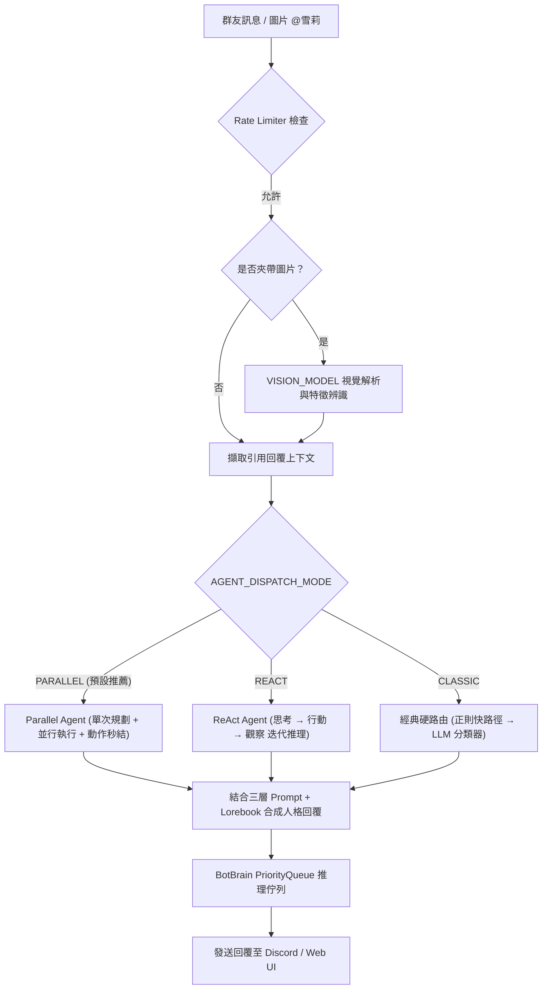

# 🤖 橘雪莉 — Discord AI Companion & Agent Platform (v1.6.0)

一個擁有獨立靈魂、會讀空氣、懂得自我反思、還會自己找樂子的 Discord 虛擬實況群友與全能 AI 代理人。  
基於 **discord.py 2.x** + **ReAct / Parallel Agent 雙智能推理架構** + **多 LLM 本地 (Ollama/LM Studio/vLLM) 與雲端 (OpenAI/Gemini/DeepSeek/Claude) 引擎** + **asyncio 優先權佇列**，支援 Linux / Docker 容器化與 Windows 跨平台部署，具備多模態視覺感知、自我形象辨識、豐富擴充模組系統 (Mod System) 與全功能 Web 視覺化主控台。

---

## ✨ 主要能力矩陣 (Core Capabilities)

| 類別 | 功能亮點 |
|---|---|
| 🧠 **智慧 Agent 架構** | **Parallel Agent** 單次規劃並行調度 · **ReAct Agent** 多輪推理工具鏈 · **Action Early Termination** 動作自適應秒結 · 複合指令自動拆解 · 自然語言 @Tag 回應 · 主動插話 (Interject) · 讀空氣 (VibeManager) · 心跳定時主動任務 (Heartbeat) |
| 👁️ **多模態視覺與認知** | **多模態圖片深度解析 (`VISION_MODEL`)** · **跨模組自我形象辨識 (`⚠️自我辨識` Lorebook 觸發)** · **引用回覆上下文感知 (Quote Context)** |
| 🛠️ **全能工具與技能庫** | 台美股即時 K 線技術分析 (`/stock`) · 即時天氣預報 (`/weather`) · 網頁深度 RAG 搜尋 (`/search`) · Safebooru/Pixiv 搜圖 · 自然語言與 cron 定時排程提醒 (`/schedule`) · `/execute` 工具獨立測試 |
| 🎨 **創作與多媒體** | Stable Diffusion 圖片生成 (`/draw`) · YouTube 音樂點播與音訊串流 (`/play`) · **YouTube 影片指定秒數轉 GIF 動圖 (`/video`)** |
| 🔌 **擴充模組 (Mod System)** | **AI 社群情報哨兵 (`feed_sentinel`)** · **美股虛擬量化交易系統 (`stock_trader`)** · **TRPG D&D 地下城主跑團 (`dnd`)** · **小遊戲遊樂場 (`game_center`)** · **技術指標晨晚報與 PTCG 追蹤 (`market_plugin`)** |
| 🎤 **語音系統 (Voice)** | Discord 語音通話 · faster-whisper STT 語音辨識 · XTTS-v2 聲音克隆 TTS · Silero VAD 語音活動檢測 · **語音房與音樂動態實時監控** |
| 🧠 **動態記憶與社交** | UID 長期記憶萃取 · **記憶物理消毒 (`sanitize_memory`) 防錯亂** · 好感度等級追蹤 (`RelationshipManager`) · 每日聊天精華摘要 (`NightlyDigest`) · **新人加入動態歡迎 (`WelcomeCog`)** |
| 🖥️ **Web 控制台 2.0** | **總覽主控台 Dashboard** (CPU/RAM/GPU/Network + Git 双版本比對) · **地端 AI 服務即時監測** (Ollama/LMS/vLLM/SD) · **美股虛擬炒股持倉看板** · **模組管理與熱重啟 (Mod Manager)** · **大腦推理佇列 (LLM Task Queue) 實時監控** |
| 🛡️ **資安與審計** | **管理員登入與操作歷史審計 (`./data/admin_audit.jsonl`)** · IP 暴力破解防禦鎖定 · 時序攻擊防禦 · Guest 唯讀模式 · 敏感 Token 掩碼防洩漏 · XSS 防護 |
| 🐧 **容器與跨平台** | **Linux / Docker 容器化完整支援** · **`0.0.0.0` 綁定自動降級** · **`.sh` / `.bat` 跨平台重啟與自動更新守護腳本** |

---

## 🧠 核心 Agent 架構與調度機制

雪莉具備業界領先的三模態動態調度架構，可透過 `.env` 的 `AGENT_DISPATCH_MODE` 或 Web UI 即時切換：



1. **Parallel Agent (並行任務調度器，預設模式)**：
   - 採用單次規劃（Single-Pass Inference）由 `PARALLEL_PLANNER_MODEL` 輸出結構化任務 JSON 與對話抑制標記 (`needs_persona_reply`)。
   - 使用 `asyncio.gather` 並行同時發動互不依賴的工具（例如：同時搜圖 + 查天氣 + 查台股走勢）。
   - 支援 **行為自適應終止 (Action Early Termination)**：若發動的工具全為 DIRECT_UI（如點歌、搜圖、畫圖）且無對話需求，動作完成即刻秒結，不產生多餘廢話文字。
2. **ReAct Agent (多輪推理與工具鏈模式)**：
   - 採用經典 Reasoning + Acting「思考→行動→觀察」迭代迴圈（`REACT_MAX_STEPS`），支援 `<thought>`、`<action>`、`<action_input>`、`<final_answer>`。
   - 適用於複雜多步驟相依推理（如：先搜尋特定新聞，再根據搜尋結果總結並畫圖）。
3. **Classic Agent (經典單意圖硬路由模式)**：
   - Phase 1 正則極速命中 → Phase 2 分類器神經判斷 → 專用工具執行。

---

## 🚀 快速開始

### 環境需求

- **作業系統**：Windows 10/11 或 Linux (Ubuntu 20.04+ / Debian 11+ / Docker)
- **Python**：3.10 ~ 3.12
- **推論後端**：[Ollama](https://ollama.com) / LM Studio / vLLM 本地運行中（或外部 OpenAI / Gemini / DeepSeek / Claude API Key）
- **多媒體支援**：FFmpeg（音樂串流與 GIF 轉檔需用）
- **GPU 算力**（建議）：NVIDIA CUDA GPU（供語音 STT/TTS、本地大模型與 Stable Diffusion 圖片生成）

### 安裝步驟

```bash
# 1. 複製專案
git clone https://github.com/YuuuuutoOuO/Sherry-An-AI-Companion-Platform.git
cd Sherry-An-AI-Companion-Platform

# 2. 建立並啟用虛擬環境
python -m venv .venv
.venv\Scripts\activate          # Windows
# source .venv/bin/activate     # Linux / Docker

# 3. 安裝相依套件
pip install -r requirements.txt
```

### 設定 `.env`

於專案根目錄建立 `.env` 檔案，範例如下：

```env
# ── Discord 必要設定 ──────────────────────────────────────
DISCORD_BOT_TOKEN=你的_DISCORD_BOT_TOKEN
ADMIN_USER_IDS=[425311733503229972]

# ── Agent 架構與調度模式 ─────────────────────────────────
AGENT_DISPATCH_MODE=PARALLEL      # PARALLEL (預設並行) | REACT (多步推理) | CLASSIC (傳統)
ACTION_EARLY_TERMINATION_ENABLED=True

# ── 本地 LLM 後端 Base URLs ──────────────────────────────
OLLAMA_BASE_URL=http://localhost:11434
LMS_BASE_URL=http://localhost:1234/v1
VLLM_BASE_URL=http://localhost:8000/v1

# ── 雲端 API Keys (選填，填入即解鎖對應雲端模型) ─────────
OPENAI_API_KEY=
GEMINI_API_KEY=
DEEPSEEK_API_KEY=
CLAUDE_API_KEY=

# ── 工具 API Keys (選填) ──────────────────────────────────
OPENWEATHERMAP_API_KEY=          # 天氣查詢
FINNHUB_API_KEY=                 # 美股即時報價與技術指標

# ── Web 控制台安全性設定 ─────────────────────────────────
WEB_UI_PASSWORD=sherry123        # Web UI 管理員登入密碼 (帳號預設為 admin)
WEB_UI_PORT=8763
WEB_UI_HTTPS=True
```

### 拉取常用模型

```bash
# 對話與推理模型 (Ollama)
ollama pull krith/mistral-nemo-instruct-2407-abliterated:IQ4_XS
ollama pull qwen2.5:3b

# 視覺辨識模型 (多模態圖片理解)
ollama pull minicpm-v
# 或 ollama pull qwen2-vl-7b-instruct
```

### 啟動雪莉

* **Windows**:
  ```bash
  python main.py
  # 或直接雙擊 restart_sherry.bat
  ```
* **Linux / Docker**:
  ```bash
  chmod +x restart_sherry.sh update_and_restart.sh
  ./restart_sherry.sh
  ```

啟動完成後，開啟瀏覽器造訪 Web 後台控制台：  
🔗 **[https://localhost:8763](https://localhost:8763)**  
（預設帳號：`admin`，密碼：同 `.env` 中之 `WEB_UI_PASSWORD`）

---

## 🔌 擴充模組系統 (Mod System)

雪莉採用鬆散耦合的 Plugin 架構，系統於啟動時自動掃描 `./mod/` 目錄下所有包含 `cog.py` 的子資料夾並嘗試載入。**任一插件出錯絕不影響雪莉核心運作！**

```
mod/
├── feed_sentinel/   # AI 社群情報哨兵與主動話題探勘
├── stock_trader/    # 雪莉美股虛擬量化交易系統
├── video_clipper/   # YouTube 影片轉 GIF 動圖製作工具
├── dnd/             # D&D TRPG AI 地下城主跑團遊戲引擎
├── game_center/     # 小遊戲遊樂場 (21點/猜拳/踩地雷/海龜湯/AI對弈)
└── market_plugin/   # 股市技術晨報、AI晚報、PTCG卡價與ETF溢折價
```

### 模組詳細介紹與指令清單

#### 1. 📰 `feed_sentinel` — AI 社群情報哨兵 & 主動話題探勘
- **功能**：每日 08:00~23:00 每 15 分鐘自動巡邏 RSS/情報來源，自動去重並由 BotBrain 提煉 3 點繁中重點與雪莉犀利銳評，主動推播至 Discord 頻道，解決群組冷場！
- **指令**：
  - `/sentinel_fetch`：手動立即觸發情報哨兵抓取與推播。

#### 2. 📈 `stock_trader` — 雪莉美股虛擬量化交易系統
- **功能**：自帶 $10,000 美金虛擬本金，美股交易時段 (台灣時間 23:00~04:00) 自動巡邏，03:50 臨關盤強制看盤。結合 AI 策略分析師 (`TradeStrategist`) 與演算法交易員 (`AlgoTrader`) 執行自動交易與風控，成交自動推播至頻道。
- **指令與 Web 支援**：
  - `!stock_status`：查看當前美股持倉、資產淨值與收益率。
  - **Web UI 炒股專屬看板**：提供視覺化未實現損益、AI 交易決策思路日誌、一鍵「刷新行情損益」與「手動評估看盤」。

#### 3. 🎬 `video_clipper` — YouTube 影片轉 GIF 動態截取
- **功能**：快速將 YouTube 指定時間片段轉換為高畫質 GIF 動圖發送至頻道。
- **指令**：
  - `/video url:<網址> start_time:<開始時間> end_time:<結束時間>`  
    *範例：`/video url:https://youtu.be/xxx start_time:1:30 end_time:1:45`*

#### 4. 🎲 `dnd` — D&D TRPG AI 地下城主跑團遊戲引擎
- **功能**：完整整合地下城主 AI (DM)、角色卡、屬性骰判定 (優勢/劣勢)、冒險行動互動與動態世界模擬。
- **指令**：
  - `/dnd_join`：創建專屬 D&D 冒險者角色卡。
  - `/dnd_session`：開啟/關閉本頻道的 D&D 自動遊戲模式。
  - `/dnd_action`：向 DM 提出冒險動作描述。
  - `/dnd_roll`：進行 D&D 擲骰判定 (支援 d20, d6, 優勢/劣勢)。
  - `/dnd_status`：查看角色卡狀態與生命值。
  - `/dnd_inventory`：查看背包裝備與物品。
  - `/dnd_world`：查看世界時間與陣營勢力狀態。

#### 5. 🎮 `game_center` — 小遊戲遊樂場
- **功能**：支援 21 點撲克 (`blackjack`)、猜拳大對決 (`rps`)、踩地雷 (`minesweeper`)、海龜湯 (`turtle_soup`)、井字棋 (`tic_tac_toe`)、密室逃脫 (`escape_room`)，並結合地端 LLM 進行雪莉名偵探個性對弈與調侃！

#### 6. 📊 `market_plugin` — 股市與卡價追蹤
- **功能**：技術指標晨報 (08:00)、Gemini AI 晚間分析 (21:30)、PTCG 卡片即時報價 (10:00)、ETF 溢折價監控 (盤中每 10 分鐘)。
- **指令**：
  - `/market_raw` / `!raw`：手動產出技術指標報告。
  - `/market_add` / `/market_remove` / `/market_list`：股票追蹤清單管理。
  - `/card_add` / `/card_remove` / `/card_list` / `/card_update`：PTCG 卡片追蹤與爬蟲更新。

---

## 💬 常用核心互動與指令指南

雪莉全面支援 **自然語言對話** 與 **Discord 斜線指令 (`/`)** 雙軌並行：

```
@雪莉 幫我播 Yoasobi 的 Idol，順便找一張雪莉的可愛圖片！   # 複合指令自動拆解並行處理
@雪莉 查一下 2330 走勢與最新新聞                          # 即時網頁 RAG + 台股 K 線
@雪莉 10分鐘後提醒我出門                                  # 自然語言排程
@雪莉 (夾帶圖片) 妳覺得這張圖好看嗎？                      # 多模態圖片視覺理解 + 自我認知
```

| 類別 | 指令 / 操作 | 說明 |
|---|---|---|
| 📖 **全能幫助** | `/help` | 叫出 Discord Select Menu 分類式全功能指南 |
| 💬 **強制執行** | `/execute intent:<TOOL> query:<內容>` | 繞過分類器直接強制指派特定工具執行 |
| 🎵 **音樂系統** | `/play` | 播放 YouTube 音樂、加入播放清單或切換曲目 |
| 🎤 **語音通話** | `/join_voice` · `/leave_voice` | 讓雪莉加入/離開目前語音頻道進行語音交談 |
| 🧠 **記憶管理** | `/memory_show` · `/memory_clear` | 查看或清除雪莉對自己的長期記憶檔案 (僅自己可見) |
| 👥 **氛圍感知** | `/vibe_show` · `/vibe_clear` | 查看或重設頻道當前熱門話題與氛圍狀態 |
| ⚙️ **系統維運** | `/restart` · `/reload` · `/stats` · `/config` | 熱重啟指定模組、查看系統統計儀表板與伺服器端配置 |

---

## 🖥️ Web UI 視覺化控制台

雪莉內建基於 **Quart** 的高質感現代化 Web 管理後台 (`https://localhost:8763`)，包含以下核心分頁：

1. **📊 總覽主控台 (Dashboard)**：實時監控 CPU / GPU / RAM / 網路資源，精確比對「🤖 運作中的雪莉 Commit」與「📦 本地最新 Git 代碼」，支援一鍵 Git Pull + 重啟更新。
2. **📋 即時日誌 (Live Logs)**：支援依事件類型 (CHAT, 插話, ERROR) 與分頁過濾，具備 Guest 日誌白名單防護。
3. **💻 系統資源 (System Metrics)**：硬體資源即時動態圖表 (Chart.js)。
4. **⏰ 任務排程 (Tasks & LLM Queue)**：即時掌握排程提醒任務與 **「🧠 大腦即時推理佇列 (LLM Task Queue)」** 優先級與深度。
5. **💬 雪莉測試室 (Chat Playground)**：免開 Discord 直接在瀏覽器與雪莉對話，**支援視覺化展開 ReAct / Parallel 思考過程標籤與 Tool Invocation**。
6. **📡 地端 AI 服務 (Local AI Monitor)**：每 5 秒自動診斷 Ollama (`11434`)、LM Studio (`1234`)、vLLM (`8000`)、Stable Diffusion (`7860`) 之連線狀態、Ping 延遲與掛載模型。
7. **🎵 語音與音樂監控 (Voice & Music Monitor)**：即時掌握雪莉所在語音房成員、音樂播放狀態與佇列預覽。
8. **📈 雪莉虛擬炒股 (Stock Trader)**：即時美股持倉、未實現損益、AI 決策歷程看板，支援一鍵手動評估看盤。
9. **🛡️ 管理員審計 (Admin Audit Log)**：完整記錄登入 IP、來源網路標籤 (Localhost / Radmin / LAN)、裝置作業系統與各項操作時間軸歷程。
10. **🧩 模組管理 (Mod Manager)**：視覺化管理 `./mod/` 各外掛模組，支援一鍵熱重啟與停用。
11. **⚙️ 系統設定 (Settings)**：即時修改 LLM 模型分配、Prompt 參數、調度模式與功能開關。

---

## 📁 專案目錄結構

```text
Sherry-An-AI-Companion-Platform/
├── data/                  # 儲存資料庫、JSONL 日誌、記憶與排程
├── file/                  # 人設定義 (AI_personality.py) 與 Soul 人格檔
├── handlers/              # 核心業務邏輯 (Cog Extensions)
│   ├── admin/             # 管理員指令與伺服器設定
│   ├── bot_brain/         # 大腦推理引擎、優先權佇列與健康檢查
│   ├── executor/          # /execute 強制執行指令
│   ├── heartbeat/         # 心跳定時主動任務
│   ├── memory/            # 長期記憶萃取、記憶消毒與每日摘要
│   ├── music/             # YouTube 留聲機音樂播放引擎
│   ├── scheduler/         # 自然語言定時提醒與 Cron 排程
│   ├── social/            # Parallel/ReAct 調度器、動態人格與各項工具
│   │   ├── actions/       # 動作定義與執行器
│   │   └── tools/         # Chat, Draw, Image, Music, Schedule, Search, Stock, Weather 工具庫
│   ├── vibe_manager/      # 頻道熱門話題與氛圍追蹤
│   ├── voice/             # 語音通話 (STT / TTS / VAD)
│   ├── help_cog.py        # /help 分類幫助選單
│   └── welcome_cog.py     # 新人加入動態歡迎
├── mod/                   # 擴充外掛模組 (可插拔)
│   ├── feed_sentinel/     # AI 社群情報哨兵
│   ├── stock_trader/      # 美股虛擬量化交易系統
│   ├── video_clipper/     # YouTube 轉 GIF 工具
│   ├── dnd/               # D&D TRPG 跑團系統
│   ├── game_center/       # 小遊戲遊樂場
│   └── market_plugin/     # 股市與卡價追蹤
├── web_ui/                # Quart Web 管理後台 (HTML/CSS/JS)
├── Docs/                  # 專案詳細技術架構與模組 API 文件
├── main.py                # 程式主入口
├── settings.py            # 全域設定中心
└── requirements.txt       # Python 相依套件清單
```

---

## 📚 技術文件

詳細架構設計、資料流與各模組 API 規格，請查閱 `Docs/` 目錄：

| 文件 | 內容 |
|---|---|
| [Docs/01_Project_Snapshot.md](./Docs/01_Project_Snapshot.md) | 架構設計 · 核心資料流 · 插件系統 · 日誌架構 |
| [Docs/02_TODO_and_Improvements.md](./Docs/02_TODO_and_Improvements.md) | 開發待辦看板 · 已完成功能追蹤 |
| [Docs/技術摘要_全系統.md](./Docs/技術摘要_全系統.md) | 系統整體技術架構深入解析 |
| [Docs/技術摘要_Web_UI.md](./Docs/技術摘要_Web_UI.md) | Web 控制台前後端技術規格 |
| [Docs/module_handlers.md](./Docs/module_handlers.md) | 所有 handlers/ 模組 Class & Function 自動生成紀錄 |

---

## 🔐 Discord Bot 權限與 Intents 設定

在 [Discord Developer Portal](https://discord.com/developers/applications) 開啟以下設定：

- **Privileged Gateway Intents**：
  - ✅ `MESSAGE CONTENT INTENT` (讀取訊息以進行對話與指令解析)
  - ✅ `SERVER MEMBERS INTENT` (新人加入歡迎系統與成員辨識)
- **OAuth2 URL Generator Scopes**：
  - `bot` · `applications.commands`
- **Bot Permissions**：
  - Send Messages · Read Message History · Add Reactions · Embed Links · Attach Files · Connect · Speak · Use Slash Commands

---

## 📋 v1.6.0 更新日誌 (Release Notes)

### 🧠 1. Parallel Agent & ReAct Agent 雙智能推理架構
- **Parallel Agent 高效並行調度 (預設)**：透過 `PLANNER_MODEL` 進行單次規劃，輸出結構化任務 JSON，使用 `asyncio.gather` 同步並行執行互不依賴的工具（如同時搜圖+查天氣+查股價），效能提升 300%！
- **Action Early Termination (動作自適應秒結)**：當發動的工具全為 DIRECT_UI（如點歌、搜圖、畫圖）且無對話需求時，動作完成即刻秒結，不產生多餘廢話文字。
- **ReAct Agent 鏈式推理**：支援經典「思考→行動→觀察」多步推理迴圈，支援 `<thought>`、`<action>`、`<action_input>` 與 `<final_answer>`，在多步驟相依任務時精準收斂。
- **調度模式動態切換 (`AGENT_DISPATCH_MODE`)**：支援 `PARALLEL` / `REACT` / `CLASSIC` 三種模式，可由 `.env` 或 Web UI 即時調整。
- **Tool Registry 全面標準化**：Chat, Draw, Image, Music, Schedule, Search, Stock, Weather 工具全面重構，支援標準 ToolResponseMode。

### 👁️ 2. 多模態視覺感知與自我形象認知 (Multimodal Vision & Self-Awareness)
- **多模態圖片深度解析 (`VISION_MODEL`)**：群友在 Discord 上傳圖片並 @雪莉 或輸入問題時，自動調用視覺模型（如 `minicpm-v` / `qwen2-vl`）進行超高細節藝術與文字解析。
- **跨模組自我形象辨識與自我意識動態觸發 (`⚠️自我辨識` Lorebook)**：當視覺解析偵測到雪莉外觀特徵（淺藍/丸子頭/甜甜圈/白鳥/偵探帽/羽毛帽等）時，自動觸發 `⚠️自我辨識` 信號，動態注入自我認知人設（雪莉會認出「這是我自己！」）。
- **引用回覆上下文感知 (Quote Context)**：回覆或引用訊息時，自動擷取被引用的上下文與對話者，融入思考提示詞。

### 🔌 3. 擴充模組系統 (Mod System) 大幅擴充
- **AI 社群情報哨兵 (`mod/feed_sentinel`)**：每 15 分鐘背景巡邏 RSS/情報來源（08:00~23:00），自動去重並由 BotBrain 提煉 3 點繁中重點與雪莉犀利銳評，主動推播至 Discord 頻道。
- **雪莉美股虛擬量化交易系統 (`mod/stock_trader`)**：具備 $10,000 虛擬本金，美股盤中交易時段（23:00~04:00）自動巡邏，03:50 臨關盤強制看盤，結合 AI 策略分析師 (`TradeStrategist`) 與演算法交易員 (`AlgoTrader`) 執行自動交易與風控，成交自動推播至頻道。
- **YouTube 影片轉 GIF 工具 (`mod/video_clipper`)**：提供 `/video` 斜線指令，快速產出指定時間片段的高畫質動態 GIF。
- **D&D TRPG 跑團系統 (`mod/dnd`)**：地下城主 AI (DM)、角色卡、屬性骰判定、冒險行動與世界模擬。
- **小遊戲遊樂場 (`mod/game_center`)**：21點、猜拳、踩地雷、海龜湯、井字棋、密室逃脫與雪莉名偵探 AI 對弈。

### 🧠 4. 記憶系統全面防護與記憶錯亂修復
- **記憶錯亂修復與清洗 (`sanitize_memory.py`)**：重構 UID 長期記憶萃取演算法，解決記憶重複注入、人設混淆與幻覺問題；統一由 `MemoryManager` 注入，避免重複消耗 10-15% Token。
- **社交好感度系統 (`RelationshipManager`)**：被 Tag、對話即時更新群友好感度與關係等級。
- **每日夜間聊天摘要 (`NightlyDigest`)**：定時整理各頻道聊天精華。

### 🖥️ 5. Web 管理控制台 2.0 深度升級
- **新增「📈 雪莉虛擬炒股」面板**：視覺化美股持倉、未實現損益、AI 決策思路日誌、一鍵「刷新行情損益」與「手動評估看盤」。
- **新增「🧩 模組管理 (Mod Manager)」面板**：視覺化管理 `./mod/` 各外掛模組，支援一鍵熱重啟與停用。
- **視覺化 ReAct / Parallel 思考推理歷程**：測試室與即時日誌面板支援結構化思考歷程與工具調用展開。

### 💬 6. 社交體驗與互動感深化
- **新人加入動態歡迎 (`WelcomeCog`)**：新成員加入伺服器時，自動以雪莉人設語氣動態生成專屬歡迎詞。
- **互動式幫助面板 (`/help`)**：提供 Discord Select Menu 分類式幫助清單。
- **動態狀態輪播 (`presence_loop`)**：自動切換生動的雪莉名偵探活動狀態。

---

## 📋 歷史更新紀錄

<details>
<summary>點擊展開 v1.5.0 歷史更新日誌</summary>

### 🐧 1. Linux & Docker 容器化跨平台相容性支援 (Linux / Docker Integration)
- **跨平台重啟腳本 (`restart_sherry.sh` & `update_and_restart.sh`)**：新增 Linux 專用 Shell 腳本，具備多重進程殺除與 8763 Socket 強制解鎖能力，支援在容器與伺服器背景無縫重啟。
- **跨平台 Web UI 後台呼叫**：`/api/restart` 與 `/api/update` 端點自動偵測操作系統 (`sys.platform`)，Windows 呼叫 `.bat`，Linux 呼叫 `.sh` (並使用 `start_new_session=True`)。
- **Socket 綁定防護與自動降級**：Web UI 監聽特定 IP 失敗時（如 Windows `WinError 10013` 或 Linux `Errno 99`），系統會自動捕捉例外並安全降級綁定至 `0.0.0.0`。

### 🚀 2. vLLM 高效能推理引擎全支援 (`vllm:` 前綴)
- **`vllm:` 專用前綴與動態路由**：`OllamaClient` 支援 `vllm:` 前綴，可直接對接 vLLM OpenAI 相容端點 (`/v1/chat/completions`)。
- **極速算力釋放**：充分利用 PagedAttention、CUDA Graphs 與硬體級 FP8 / BF16 Tensor Cores，針對 NVIDIA L40S / H100 等企業級 GPU 釋放數倍的超高速 Token 生成能力。
- **Web UI 模型代理 API**：新增 `/api/models/vllm` 代理端點，即時同步 vLLM 目前掛載之模型名稱。

### ⚙️ 3. 環境變數優先級與 Unicode 編碼容錯
- **`.env` 最高優先級保護**：修復舊版 `data/config_override.json` 會強行覆蓋 `.env` 容器網路設定的問題，確保 `.env` 中設定的 `OLLAMA_BASE_URL` / `LMS_BASE_URL` / `VLLM_BASE_URL` 擁有最高優先級。
- **Unicode / ANSI 解碼容錯**：`settings.py` 的 `load_dotenv` 加上 `UTF-8` 強制編碼與 Exception 捕獲保護，防止非標準 UTF-8 `.env` 檔案導致程式崩潰。
- **動態 Base URL 屬性**：`OllamaClient` 改用 Dynamic Property 屬性讀取，避免舊版在 `import` 階段固定預設值導致的連線位址滯後問題。

### 🛠️ 4. NumPy 2.x 相容性與 FFmpeg 音樂播放日誌淨化
- **NumPy C-API 相容**：鎖定 `numpy>=1.24.0,<2.0.0` 與 `soxr==0.3.7`，解決 `TTS` / `librosa` / `transformers` 語音模組在 NumPy 2.x 下 `cimport` 崩潰的問題。
- **FFmpeg 無害日誌過濾**：音樂播放引擎加入 `-loglevel error` 與跨平台 `ffmpeg` 執行檔自動搜尋，徹底屏蔽 YouTube HLS/Live 串流在 Google CDN 節點切換時的無害警告洗版。

</details>

<details>
<summary>點擊展開 v1.4.1 歷史更新日誌</summary>

### 🧠 1. 大腦即時推理佇列監控 (LLM Task Queue)
- **實時任務佇列**：Web UI「⏰ 任務與佇列」新增 **「🧠 大腦即時推理佇列 (LLM Task Queue)」** 面板，實時展示 `BotBrain._queue` 中正在等待 GPU 運算與派發執行的 `InferenceTask` 佇列。
- **詳細任務資訊**：顯示 Priority Priority、序號 Sequence ID、指定模型 Model 名稱與 Prompt 前 120 字元預覽。

### 📡 2. 地端 AI 服務即時監測 (Local AI Services Monitor)
- **多引擎健康度與延遲診斷**：新增「📡 地端 AI 服務」分頁，每 5 秒自動診斷與輪詢：
  - **Ollama Engine** (埠號 `11434`)：監測連線 Ping 延遲與目前已載入記憶體之模型。
  - **LM Studio Engine** (埠號 `1234`)：監測連線 Ping 延遲與預設載入模型。
  - **Stable Diffusion WebUI** (埠號 `7860`)：監測 API 連線狀態與當前預設 Checkpoint / VAE 模式。

### 🛡️ 3. 管理員登入與操作歷史審計紀錄 (Admin Audit Log)
- **多管理員帳號識別 (`username`)**：Web UI 登入 Modal 新增帳號輸入欄位，支援未來多位管理員分別登入。
- **JSONL 落盤記錄 (`./data/admin_audit.jsonl`)**：
  - **IP 與來源網路標籤**：智慧解析與區分 `Localhost`、`Radmin VPN (26.x.x.x)` 與 `LAN` 區域網路。
  - **裝置與瀏覽器解析**：拆解 User-Agent 記錄操作作業系統 (Windows/Mac/Linux/iOS/Android) 與瀏覽器。
  - **操作履歷歷程 (Actions Timeline Modal)**：每次 Session 中修改系統設定、測試對話、重啟 Bot、Git Pull 等操作全數紀錄，並可在 Web UI 點擊彈窗展開時間軸歷程！

### 🎵 4. 語音頻道與留聲機音樂動態監控 (Voice & Music Live Monitor)
- **語音房與成員列表**：即時輪詢雪莉當前加入的 Discord 伺服器名稱、語音房間 (Voice Channel) 與現場通話成員。
- **播放器狀態與歌單預覽**：呈現「▶️ 播放中 / ⏸️ 暫停中 / ⏹️ 空閒中」狀態標籤、當前曲目點歌者、時間長度以及預覽佇列剩餘曲目 (Queue)。

### ⚡ 5. 耗時與極速回應優化 (`latency_ms`)
- **全管線耗時紀錄**：記錄由使用者發送訊息至大腦生成完畢的真實毫秒數 (`latency_ms`)，落盤至 `runtime_log.jsonl` 並在 Web UI 卡片標示 `⚡ 耗時 XXX ms`。

### 📊 6. Dashboard 總覽主控台 & 實時 Git 版本雙重比對
- **預設 Landing 首頁**：連線 Web UI 後優先展示「📊 總覽主控台」，一目瞭然掌握全系統運作與 Git 代碼庫快照。
- **實時雙重 Git 版本比對**：精確比對「🤖 目前運作中的雪莉 Commit (Bot Process)」與「📦 本地磁碟 Commit (Latest Code)」。

</details>

---

## 📄 License

本專案採用 [MIT License](LICENSE) 授權開源。